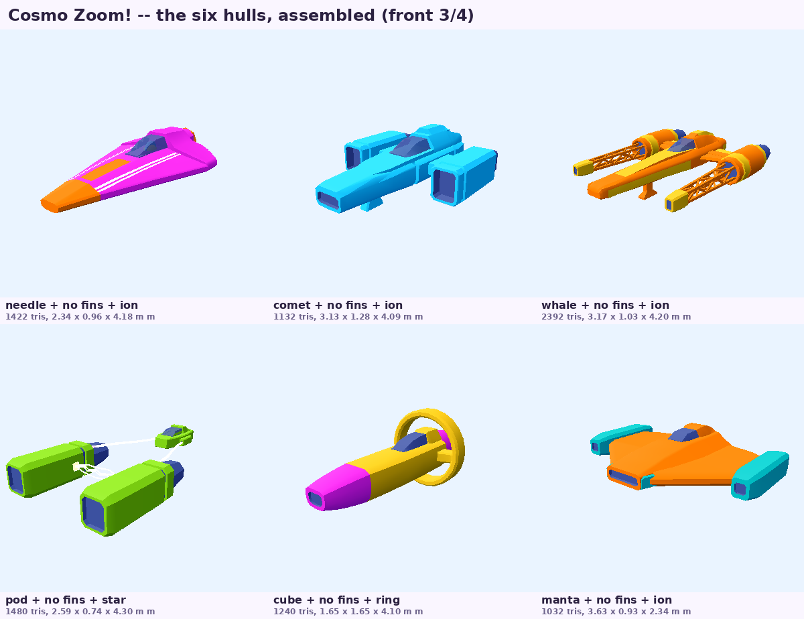
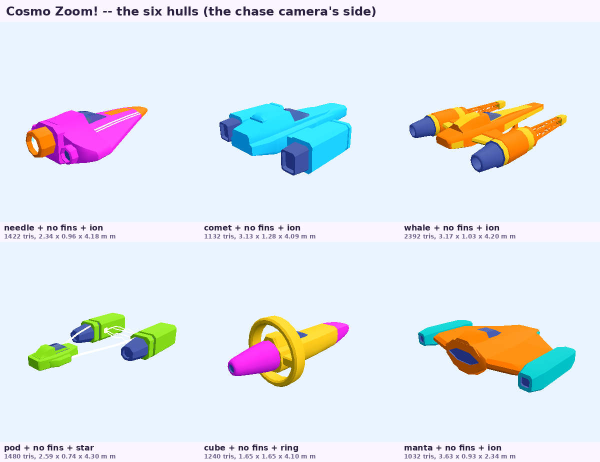
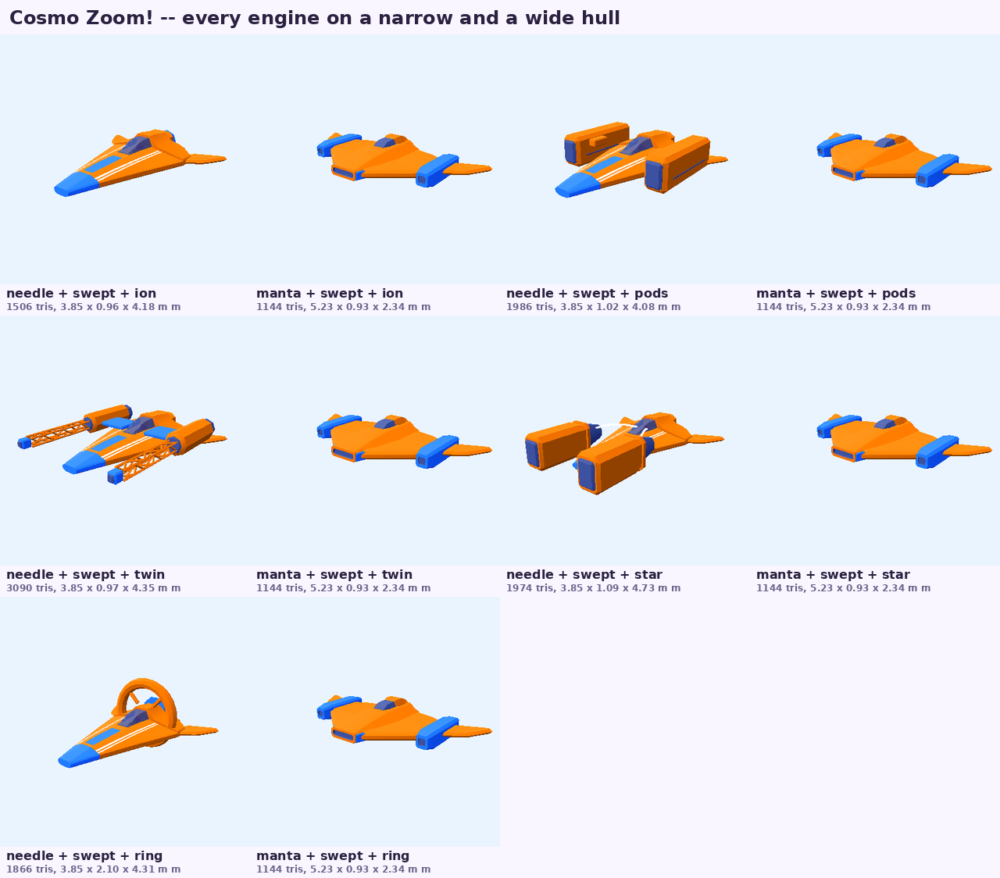
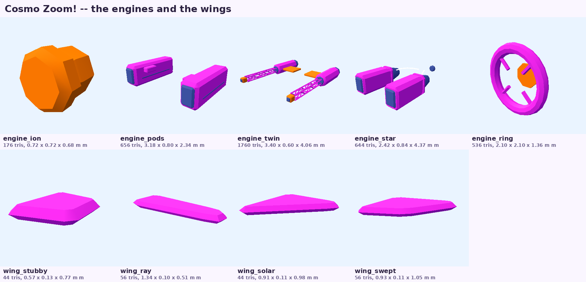
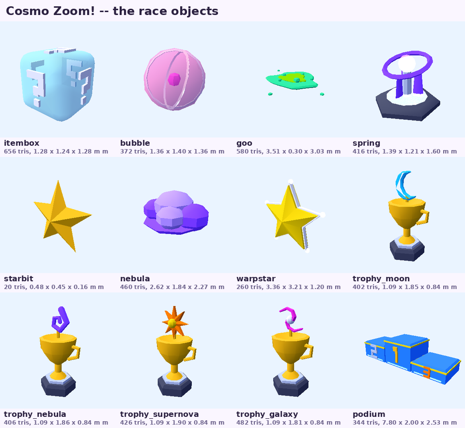
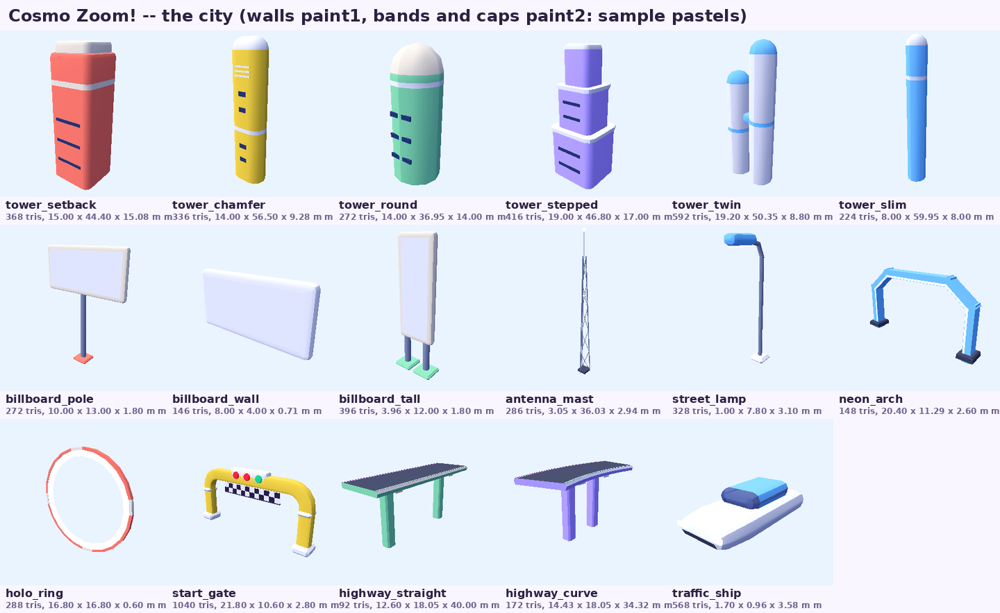
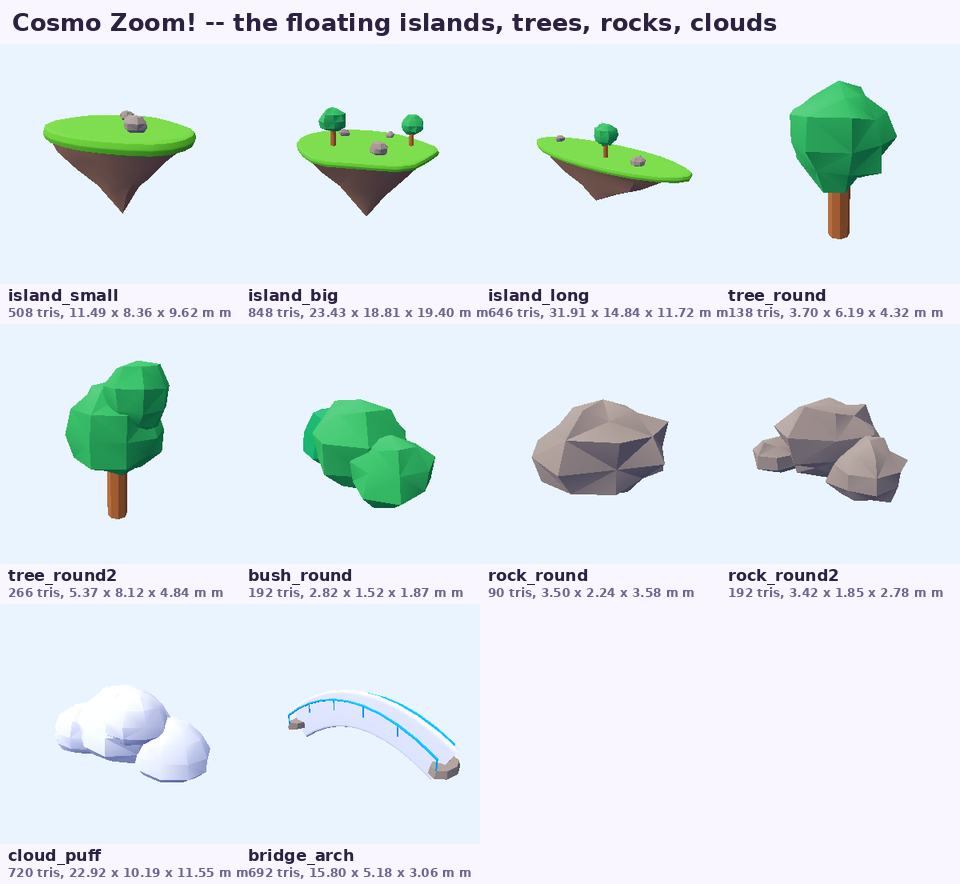

# Cosmo Zoom! — the 3D models

*Every model of the game is made by code, from Python scripts in `tools/cosmozoom/models/` (our own, MIT), plus
a few public-domain (CC0) props converted by `import_cc0.py`. The files go to
`sdcard/apps/cosmozoom.app/models/<name>.obj`, with one shared material file `cosmo.mtl`.*

**The look** (the user's final art direction, 2026-10-15, the approved image `docs/cosmozoom/refs/art-direction.png`):
3D low-poly with slightly **rounded, bevelled** shapes (the asset-pack style), soft light, solid vivid-pastel
colours, **no outline**, no neon, no faces. Every edge is rounded or chamfered (three segments a corner: the game
lights smoothly and keeps only the edges sharper than ~40° hard); glows only in the nozzles' cores.



## 1. Regenerating

```sh
python3 tools/cosmozoom/models/build_all.py            # every .obj + cosmo.mtl (+ the table below)
python3 tools/cosmozoom/models/build_all.py --sheets   # + the contact sheets in docs/cosmozoom/models/
python3 tools/cosmozoom/models/preview.py hull_needle  # one model, 4 views, by the game's renderer
python3 tools/cosmozoom/models/preview.py --ship hull_comet wing_stubby engine_pods pilot_bloop
```

The previews and the sheets are drawn by `tools/tests/cosmozoom/objview.cpp` (compiled to `/tmp/objview` on the
first use) with `paint1` / `paint2` given sample colours; it still draws a black outline, which the game no longer
does. `import_cc0.py` needs the two CC0 packs (`CZ_KAYKIT`, `CZ_KENNEY`; it skips quietly without them, and the
converted files stay in the repository).

| Script | What it makes |
|---|---|
| `czmodel.py` | the little modeller: lofts through section rings, revolutions, spheres, tori, tubes along paths, bevelled slabs from 2D outlines; moves, mirrors, merges; materials per face; the `.obj` / `.mtl` writer (welded vertices, triangles, outward winding by signed volume, UVs) |
| `soft.py` | the rounded toolkit of the final look: lofts through rounded-rectangle sections with rounded ends, rounded boxes, bevelled cylinders, nozzles with a glowing core, rounded fins, lumpy low-poly blobs |
| `ships.py` | the 6 hulls, the 5 engines, the 4 wings |
| `pilots.py` | the 8 pilots |
| `items.py` | the race objects, the trophies, the podium |
| `city.py` | the city: the capsule towers, the signs, the lamp, the start gate, the flying car (+ the earlier neon pieces) |
| `nature.py` | the floating islands, round trees, bushes, rocks, the puffy cloud, the arched bridge |
| `import_cc0.py` | the CC0 props (`kk_*` from KayKit, `kn_*` from Kenney) |
| `preview.py`, `build_all.py` | the previews, the contact sheets, this table |

## 2. Conventions

- Metres; **+Y up, +Z forward** (a ship's nose), right-handed: a ship's **left is +X**. Faces counter-clockwise
  seen from outside (the game culls back faces); triangles only; no normals (the game computes them).
- **Sockets**: comment lines `#@ name x y z`. **Groups** (`o name`): the parts the game may move.
- Each `.obj` starts with `mtllib cosmo.mtl`; `vt` UVs: a side projection over the model's length (z) and height
  (y), 0..1 (the paint patterns); the signs' picture panels have their own 0..1 UVs.
- **Origins**: a hull at the ship's centre, y = 0 the hover pads' level (under the hull); a wing at its root (made
  for the +X side: the game mirrors it to −X); an engine at its front centre (the hull's `engine` socket); a pilot at
  the neck; a floating island at the centre of its grass top (y = 0 on the grass); the item capsule, the bubble, the
  star bit, the storm cloud, the warp star and the puffy cloud at their centre; everything else on y = 0 at the
  centre of its base.

### 2.1 The materials (`cosmo.mtl`, 47 of the loader's 48)

| Kind | Names |
|---|---|
| the player's colours / the city's walls (recoloured by the game) | `paint1` (a ship's body, a tower's walls), `paint2` (a ship's second colour block: noses, trims, fins; a tower's bands and rounded top) |
| fixed colours | `white`, `cream`, `ink`, `darkgrey` / `grey` / `silver` (mechanics: nozzles, intakes, trusses, poles), `navy` (window slots, visors), `pink`, `magenta`, `yellow`, `orange`, `red`, `mint`, `green`, `teal`, `cyan`, `sky`, `blue`, `grape`, `lavender`, `gold`, `peach`, `sand`, `stone`, `wood`, `grass`, `leaf`, `darkgreen`, `rock`, `pebble` |
| see-through | `tint` (the ships' dark-blue canopies, d 0.62), `holo` (the item capsule, d 0.40), `glass` (d 0.35), `bubble` (d 0.45) |
| glowing (`*_glow`: unlit, added) | in the final look **only the nozzles' cores**: `cyan_glow`, `purple_glow`, `magenta_glow`; the others (`plasma_glow`, `yellow_glow`, `lime_glow`, `pink_glow`, `orange_glow`, `red_glow`) stay for the earlier neon pieces |
| unlit (`Ke`) | `white_flat` (lamps' lights, the flying car's headlights), `ink_flat` |

## 3. The ships

A ship = a hull + the wing (twice, mirrored) + an engine + a pilot, put together by `scene.h buildShip`. As in the
approved image:

| Hull (file) | The image's ship | Look | Usual engine |
|---|---|---|---|
| `hull_needle` | Nova Streak | a long rounded paint1 wedge, three white stripes along its top, a big rounded paint2 nose block, a dark canopy at the back, a paint2 spoiler | `engine_ion` |
| `hull_comet` | Comet Chaser | a chunky rounded body (a paint2 band along its sides) and a raised cabin (a paint2 roof, a tinted windscreen and side windows), a dark intake in the nose under a white light bar | `engine_pods` |
| `hull_whale` | Star Drifter | a long rounded paint1 body, a rounded paint2 front block with a dark grille, a canopy, a rounded paint2 fin | `engine_twin` |
| `hull_pod` | Plasma Runner | a small rounded capsule cockpit (paint1, a paint2 nose and tail band), a canopy | `engine_star` |
| `hull_cube` | Ringmaster | a rounded torpedo (paint1, a paint2 side band) with a round paint2 nose, a canopy | `engine_ring` |
| `hull_manta` | Manta Ray | a wide flat rounded paint1 delta, a raised paint2 spine and nose, a canopy, **two paint2 pods built in at its tips** (`flame3`, `flame4`) | `engine_ion` |

Sockets on every hull: `wing`, `engine` (**always at y 0.42**, the centre of its back), `pilot`, `pad1`–`pad4`
(the hover pads are no longer modelled: the game draws their glow at these points, under the hull). The wings sit
high on the shoulders so that the side engines pass under them.

| Engine (file) | Look | Sockets / groups |
|---|---|---|
| `engine_ion` | one big dark rounded nozzle with a cyan core, a paint2 collar | `flame1` |
| `engine_pods` | two boxy rounded paint1 pods along the hull's sides (forward of the socket), dark front intakes, a paint2 stripe, dark nozzles with cyan cores, dark pylons | `flame1`, `flame2` |
| `engine_twin` | two rounded paint1 nacelles (paint2 fronts with a dark intake, purple cores) held out on grey lattice trusses from a dark central block | `flame1`, `flame2` |
| `engine_star` | two long rounded paint1 pods **out ahead** of the hull (z +2.3…+4.7 from the socket, x ±1.3), paint2 ends, purple intakes, magenta cores, a fin on each, dark cables to the hull | `flame1`, `flame2`, **`arc1`, `arc2`** (the inner faces: the game draws the arc between them) |
| `engine_ring` | a big rounded paint1 ring standing over the tail, a paint2 hub and four spokes, a paint2 core with a dark nozzle and a magenta core | `flame1`; `o ring` + socket `ring` (its centre: it can spin about Z) |

| Wing (file) | Look |
|---|---|
| `wing_stubby` | Stubby Fins: short thick rounded trapezoids |
| `wing_ray` | Ray Wings: long straight rounded blades |
| `wing_solar` | Delta Fins: a small rounded delta |
| `wing_swept` | Swept Fins: rounded swept-back fins |

Assembled ships weigh **1800–2650 triangles** (the heaviest: `hull_manta` with `engine_pods` or `engine_twin`;
the six ships of the image 1800–2400). Known overlaps (small, accepted): on the very wide `hull_manta` the side engines touch its tip pods.





## 4. The pilots

Eight racing pilots (no faces): a rounded helmet with a `navy` visor and its glint, the shoulders in the racing
suit, each in its own colours and with its own helmet (side fins, ear cups, a crest, antennae, a ridge, rear
blades). Origin at the neck (the hull's `pilot` socket), facing +Z; groups **`o head`** (it turns) and **`o body`**.
The files keep the first cast's names: `pilot_pepper`, `pilot_bruno`, `pilot_bolt`, `pilot_zib`, `pilot_beep`,
`pilot_bloop`, `pilot_squiggle`, `pilot_kiki`. They sit under the tinted canopies.


## 5. The race objects

| File | Look | Notes |
|---|---|---|
| `itembox` | the item capsule: a translucent rounded `holo` cube 1.2 m, a bold white "?" (five bars) on its four sides and its top | `o shell` |
| `bubble` | the plasma bubble 1.4 m: a see-through pink sphere, two white rings, a magenta core | |
| `goo` | the ion goo: a mint puddle 3 m × 0.3 m, bubbles and droplets | on the ground |
| `spring` | the gravity well: a hexagonal pad, three grape blades, an orb, a tilted ring | `o ring`, socket `ring` |
| `starbit` | a faceted gold star 0.5 m | |
| `nebula` | the storm cloud: grape and lavender puffs, two lightning bolts | no face |
| `warpstar` | a big yellow star 3 m with a white rim | |
| `trophy_moon` … `trophy_galaxy` | a gold cup on a plinth, the cup's emblem over it | |
| `podium` | three steps, the numbers 1 2 3 as geometry | |



## 6. The city

Rounded **capsule towers** like the image: walls in **`paint1`** (the game picks the pastel: coral, lemon, mint,
lavender, white, sky), horizontal bands and the rounded top in **`paint2`**, plain `navy` / `white` window slots
(no neon).

| File | Look |
|---|---|
| `tower_chamfer` | a tall pill slab (14 × 9 m, 56 m): a band, a rounded paint2 top, white vents, dark slots |
| `tower_setback` | a rounded box (15 m, 44 m): a band near the top, a rounded paint2 cap block, dark slots |
| `tower_stepped` | three stepped rounded blocks with paint2 ledges, dark slots (47 m) |
| `tower_twin` | two round pills of two heights (50 and 40 m) joined by a rounded paint2 bridge |
| `tower_slim` | a slim round capsule (8 m wide, 60 m), a band, a round paint2 top |
| `tower_round` | a round tower with a paint2 dome (14 m wide, 37 m), a white band, dark slots |
| `billboard_pole`, `billboard_wall`, `billboard_tall` | rounded signs: a paint2 rounded frame, the picture panel **`o panel`** (white, UVs 0..1 for the game's picture), on a grey pole / for a wall / on two legs, paint1 feet |
| `street_lamp` | a rounded lamp: a grey pole bent over, a paint2 head, a white light |
| `start_gate` | the start gate: a rounded paint1 arch over the 16 m track (paint2 feet and collars), a checker banner, a paint2 box with **three lights `o light1`, `o light2` (red) and `o light3` (mint)** on both faces |
| `traffic_ship` | a small rounded flying car (3.6 m): a paint1 body, a paint2 cabin with tinted windows, white headlights, red tail lights |
| `antenna_mast`, `neon_arch`, `holo_ring`, `highway_straight`, `highway_curve` | the earlier neon-night pieces, kept |



## 7. The floating islands and nature

| File | Look |
|---|---|
| `island_small` (11 m), `island_big` (23 m), `island_long` (32 m) | a flat `grass` top with a rounded edge over an inverted low-poly cone of `rock`, rounded `pebble` boulders on top (and round trees on the big and long ones); origin at the centre of the grass top |
| `tree_round`, `tree_round2` | a round low-poly canopy on a short trunk (6 m); one with three lumps (7 m) |
| `bush_round` | three rounded lumps (2.8 m) |
| `rock_round`, `rock_round2` | a rounded rock (3.5 m); a group of three |
| `cloud_puff` | six low-poly white balls, a flatter bottom (23 m wide); origin at its centre |
| `bridge_arch` | a small arched white bridge (16 m) with sky-blue rails, on two stone feet |



## 8. Imported CC0 props

Converted by `import_cc0.py`: the pack's palette texture sampled at each face's UV centre and baked into the
vertices (`v x y z r g b`), scaled to metres, the origin at the base's centre. Public domain (CC0); credited in each
file's header:

- **KayKit Space Base Bits** by Kay Lousberg (CC0, www.kaylousberg.com): `kk_basemodule_a`, `kk_basemodule_c`,
  `kk_dome` (its glass in `glass`), `kk_landingpad`, `kk_solarpanel`, `kk_structure_tall`, `kk_water_storage`,
  `kk_windturbine` (the blades as **`o fan`**, socket `fan` at the hub: they spin about Z), `kk_cargo_stack`,
  `kk_rock_a`, `kk_rocks_a`.
- **Toy Car Kit** by Kenney (CC0, www.kenney.nl): `kn_tree`, `kn_tree_pine`, `kn_cone`. No car.


## 9. Every file

Generated by `build_all.py` (the triangles as the game counts them):

<!-- table -->
| Model | Triangles | Size x × y × z (m) | Sockets | Groups | Script |
|---|---|---|---|---|---|
| `antenna_mast` | 286 | 3.05 × 36.03 × 2.94 | — | — | city.py |
| `billboard_pole` | 272 | 10.00 × 13.00 × 1.80 | — | panel | city.py |
| `billboard_tall` | 396 | 3.96 × 12.00 × 1.80 | — | panel | city.py |
| `billboard_wall` | 146 | 8.00 × 4.00 × 0.71 | — | panel | city.py |
| `bridge_arch` | 692 | 15.80 × 5.18 × 3.06 | — | — | nature.py |
| `bubble` | 372 | 1.36 × 1.40 × 1.36 | — | — | items.py |
| `bush_round` | 192 | 2.82 × 1.52 × 1.87 | — | — | nature.py |
| `cloud_puff` | 720 | 22.92 × 10.19 × 11.55 | — | — | nature.py |
| `engine_ion` | 176 | 0.72 × 0.72 × 0.68 | flame1 | — | ships.py |
| `engine_pods` | 656 | 3.18 × 0.80 × 2.33 | flame1, flame2 | — | ships.py |
| `engine_ring` | 536 | 2.10 × 2.10 × 1.35 | ring, flame1 | ring | ships.py |
| `engine_star` | 644 | 2.42 × 0.84 × 4.37 | flame1, arc1, flame2, arc2 | — | ships.py |
| `engine_twin` | 1760 | 3.40 × 0.60 × 4.06 | flame1, flame2 | — | ships.py |
| `goo` | 580 | 3.51 × 0.30 × 3.03 | — | — | items.py |
| `highway_curve` | 172 | 14.43 × 18.05 × 34.32 | — | — | city.py |
| `highway_straight` | 92 | 12.60 × 18.05 × 40.00 | — | — | city.py |
| `holo_ring` | 288 | 16.80 × 16.80 × 0.60 | — | glow | city.py |
| `hull_comet` | 1132 | 3.13 × 1.28 × 4.09 | noengine, nopilot, flame1, flame2, pad1, pad2, pad3, pad4, wing, engine, pilot | — | ships.py |
| `hull_cube` | 1240 | 1.65 × 1.65 × 4.10 | ring, noengine, nopilot, flame1, pad1, pad2, pad3, pad4, wing, engine, pilot | ring | ships.py |
| `hull_manta` | 1032 | 3.63 × 0.93 × 2.33 | noengine, nopilot, flame1, flame2, flame3, pad1, pad2, pad3, pad4, wing, engine, pilot | — | ships.py |
| `hull_needle` | 892 | 2.34 × 0.96 × 3.84 | pad1, pad2, pad3, pad4, wing, engine, pilot | — | ships.py |
| `hull_pod` | 1480 | 2.59 × 0.74 × 4.30 | noengine, nopilot, flame1, flame2, pad1, pad2, pad3, pad4, wing, engine, pilot | — | ships.py |
| `hull_whale` | 2392 | 3.17 × 1.03 × 4.21 | noengine, nopilot, flame1, flame2, pad1, pad2, pad3, pad4, wing, engine, pilot | — | ships.py |
| `island_big` | 848 | 23.43 × 18.81 × 19.40 | — | — | nature.py |
| `island_long` | 646 | 31.91 × 14.84 × 11.72 | — | — | nature.py |
| `island_small` | 508 | 11.49 × 8.36 × 9.62 | — | — | nature.py |
| `itembox` | 656 | 1.28 × 1.24 × 1.28 | — | shell | items.py |
| `kk_basemodule_a` | 586 | 15.74 × 7.00 × 15.23 | — | — | import_cc0.py |
| `kk_basemodule_c` | 644 | 14.00 × 7.00 × 15.44 | — | — | import_cc0.py |
| `kk_cargo_stack` | 488 | 3.00 × 3.00 × 3.00 | — | — | import_cc0.py |
| `kk_dome` | 136 | 15.20 × 8.00 × 15.20 | — | — | import_cc0.py |
| `kk_landingpad` | 478 | 15.00 × 3.00 × 15.00 | — | — | import_cc0.py |
| `kk_rock_a` | 30 | 6.40 × 3.00 × 6.00 | — | — | import_cc0.py |
| `kk_rocks_a` | 88 | 7.42 × 2.00 × 9.28 | — | — | import_cc0.py |
| `kk_solarpanel` | 118 | 6.07 × 2.50 × 3.03 | — | — | import_cc0.py |
| `kk_structure_tall` | 670 | 14.00 × 16.00 × 14.00 | — | — | import_cc0.py |
| `kk_water_storage` | 326 | 15.24 × 8.00 × 15.62 | — | — | import_cc0.py |
| `kk_windturbine` | 632 | 8.88 × 16.00 × 5.33 | fan | fan | import_cc0.py |
| `kn_cone` | 132 | 0.78 × 0.80 × 0.78 | — | — | import_cc0.py |
| `kn_tree` | 196 | 4.13 × 7.00 × 4.13 | — | — | import_cc0.py |
| `kn_tree_pine` | 228 | 6.04 × 9.00 × 6.04 | — | — | import_cc0.py |
| `nebula` | 460 | 2.62 × 1.83 × 2.27 | — | — | items.py |
| `neon_arch` | 148 | 20.40 × 11.29 × 2.60 | — | — | city.py |
| `pilot_beep` | 374 | 0.54 × 0.68 × 0.37 | — | body, head | pilots.py |
| `pilot_bloop` | 326 | 0.54 × 0.68 × 0.43 | — | body, head | pilots.py |
| `pilot_bolt` | 354 | 0.54 × 0.75 × 0.39 | — | body, head | pilots.py |
| `pilot_bruno` | 374 | 0.54 × 0.68 × 0.37 | — | body, head | pilots.py |
| `pilot_kiki` | 326 | 0.54 × 0.68 × 0.49 | — | body, head | pilots.py |
| `pilot_pepper` | 326 | 0.54 × 0.68 × 0.43 | — | body, head | pilots.py |
| `pilot_squiggle` | 334 | 0.54 × 0.73 × 0.44 | — | body, head | pilots.py |
| `pilot_zib` | 404 | 0.54 × 0.83 × 0.37 | — | body, head | pilots.py |
| `podium` | 344 | 7.80 × 2.00 × 2.53 | — | — | items.py |
| `rock_round` | 90 | 3.50 × 2.24 × 3.58 | — | — | nature.py |
| `rock_round2` | 192 | 3.42 × 1.85 × 2.78 | — | — | nature.py |
| `spring` | 416 | 1.39 × 1.21 × 1.60 | ring | ring | items.py |
| `starbit` | 20 | 0.48 × 0.45 × 0.16 | — | — | items.py |
| `start_gate` | 1040 | 21.80 × 10.60 × 2.80 | — | light1, light2, light3 | city.py |
| `street_lamp` | 328 | 1.00 × 7.80 × 3.10 | — | — | city.py |
| `tower_chamfer` | 336 | 14.00 × 56.50 × 9.28 | — | — | city.py |
| `tower_round` | 272 | 14.00 × 36.95 × 14.00 | — | — | city.py |
| `tower_setback` | 368 | 15.00 × 44.40 × 15.08 | — | — | city.py |
| `tower_slim` | 224 | 8.00 × 59.95 × 8.00 | — | — | city.py |
| `tower_stepped` | 416 | 19.00 × 46.80 × 17.00 | — | — | city.py |
| `tower_twin` | 592 | 19.20 × 50.35 × 8.80 | — | — | city.py |
| `traffic_ship` | 568 | 1.70 × 0.96 × 3.58 | — | — | city.py |
| `tree_round` | 138 | 3.70 × 6.19 × 4.32 | — | — | nature.py |
| `tree_round2` | 266 | 5.37 × 8.12 × 4.84 | — | — | nature.py |
| `trophy_galaxy` | 482 | 1.09 × 1.81 × 0.84 | — | — | items.py |
| `trophy_moon` | 402 | 1.09 × 1.85 × 0.84 | — | — | items.py |
| `trophy_nebula` | 406 | 1.09 × 1.86 × 0.84 | — | — | items.py |
| `trophy_supernova` | 426 | 1.09 × 1.90 × 0.84 | — | — | items.py |
| `warpstar` | 260 | 3.36 × 3.21 × 1.20 | — | — | items.py |
| `wing_ray` | 56 | 1.34 × 0.10 × 0.51 | — | — | ships.py |
| `wing_solar` | 44 | 0.91 × 0.11 × 0.98 | — | — | ships.py |
| `wing_stubby` | 44 | 0.57 × 0.13 × 0.77 | — | — | ships.py |
| `wing_swept` | 56 | 0.93 × 0.11 × 1.05 | — | — | ships.py |
<!-- /table -->

## 10. For the programmer

- The names in `parts.h` may differ from these files: the files are the ones above.
- The hull's `flame*` sockets are read by `buildShip` too: `hull_manta`'s `flame3` / `flame4` give its tip pods
  their trails.
- `engine_star`'s pods reach 4.7 m ahead of the `engine` socket (ahead of the short `hull_pod`, as in the image).
- The hover pads are no longer geometry: draw their glow at `pad1`–`pad4`.
- `itembox` is one group now (`o shell`, the "?"s on its faces turn with it).
- The loader keeps 24 groups, 24 sockets and 48 materials a model: `cosmo.mtl` has 47 — **adding a material
  means removing one**.

## Imported ships (generated GLB)

The user made the six ships with a generative 3D tool from the reference sheet (2026-10-15, GLB files). Each is
rebuilt parametrically in `ships.py` from measurements of its GLB (cross-sections every 0.1-0.2 m, the colours'
extents), within ~0.01-0.02 m of it: `hull_needle` (Nova Streak, 892 triangles), `hull_comet` (Comet Chaser, 1132),
`hull_whale` (Star Drifter, 2392), `hull_pod` (Plasma Runner, 1480), `hull_cube` (Ringmaster, 1240), `hull_manta`
(Manta Ray, 1032). The hulls with their engines built in carry a `noengine` socket (the engine part is not drawn,
its stats still count; the flames leave the hull's `flame*` sockets) and those with an opaque canopy `nopilot`.

