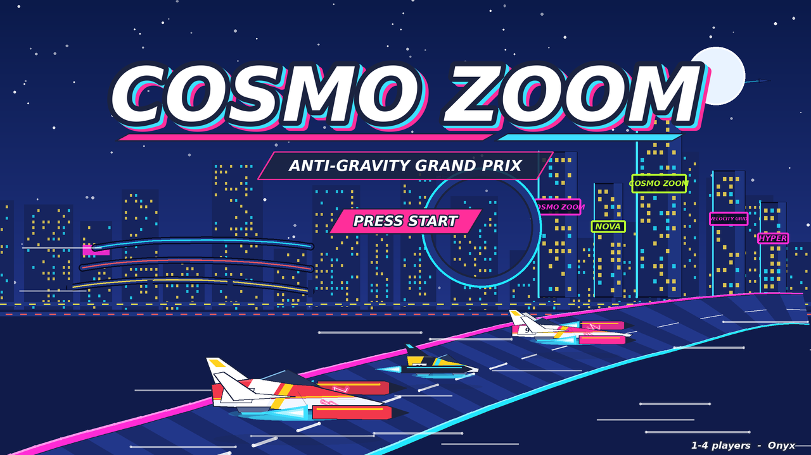
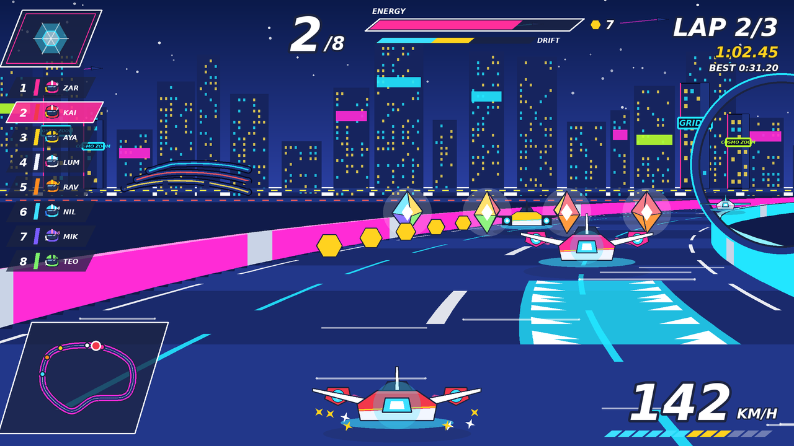
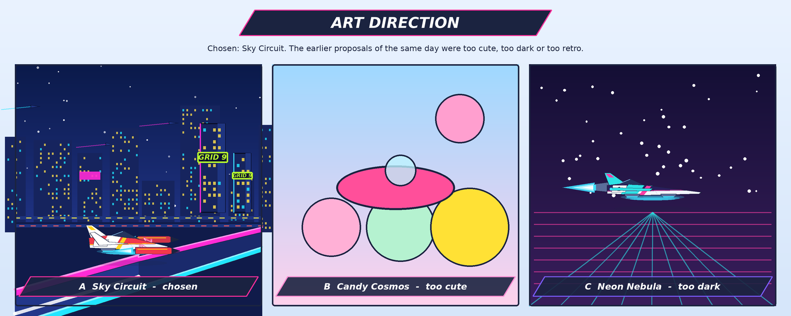
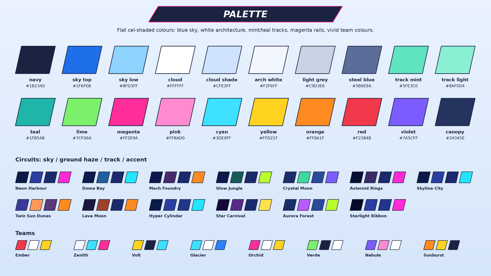
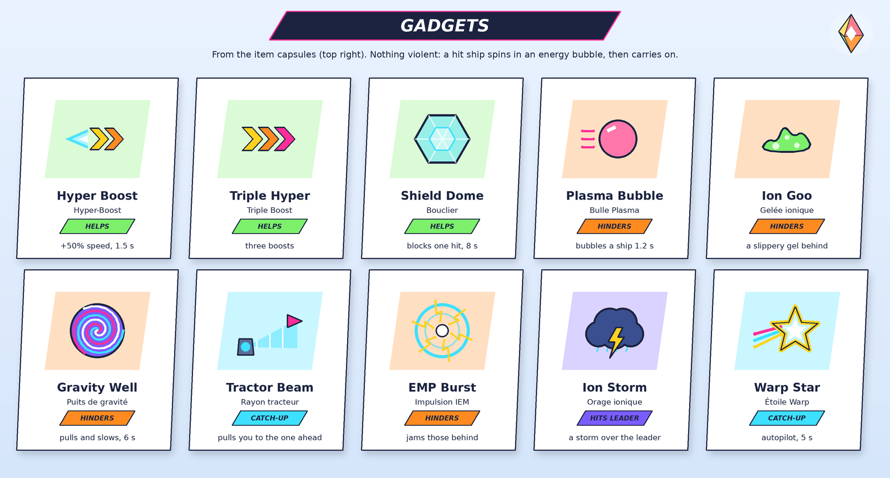
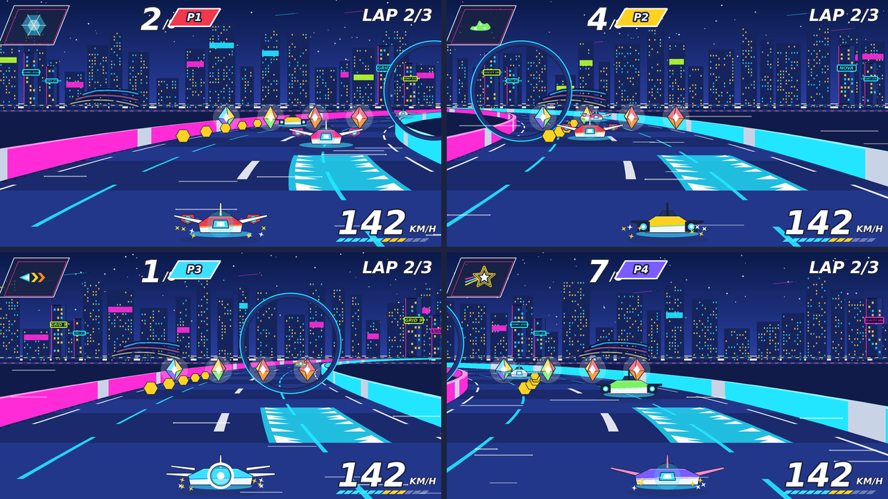

# Cosmo Zoom — design

*A native 3D anti-gravity racer for Onyx (Raspberry Pi 4). It is a **neon-night arcade racer** with a
**cel-shaded comic-book look**: angular hover ships with long glowing trails race at night through futuristic
neon cities, on dark-blue roads streaked with light, between glowing magenta and cyan rails. The colours are
vivid and saturated, with dark outlines. It is not cute, and it is friendly for children: no violence, no gore. The spirit comes from `sdcard/basic/examples/antigrav.bas` (the spline track, the banked turns,
the speed pads, the split screen). From the kart-racing genre it takes the items, the cups and the catch-up.
Our own twist is the **tube sections** that you ride on the *outside* of a cylinder. Every name, model,
texture and tune here is our own. MIT licence (the Onyx authors, 2026).*

**App name**: `cosmozoom`. The program is `user/Apps/cosmozoom/`; on the card it is `sdcard/apps/cosmozoom.app/`
(`main`, `models/`, `lang/fr.txt`, `times.txt`, `save.ini`). On-screen title: **COSMO ZOOM**, with the subtitle
*Anti-Gravity Grand Prix* (FR: *Grand Prix Antigravité*).

**Mock-ups** are made by `python3 tools/hoverkart/mockups.py` in `docs/hoverkart/mockups/`. The script's
`CIRCUITS` / `CUPS` tables hold the same 13 circuits and 4 cups as §7 (the mock-ups show the night look; the
HUD mock-ups predate the final HUD layout of §9, which is the reference). It is one list: change both together.

| | |
|---|---|
|  |  |
|  |  |

**Revision history**
- **2026-10-15 a**: a cute candy-cartoon version (animal mascots, chubby ships). Then, at the user's request:
  sci-fi ships, candy colours, less neon. Then the CC0 style references (§3.0).
- **2026-10-15 b** (this version): the user does **not want the cute style**. Their reference is the look of
  *Aero GPX*, an F-Zero-like indie racer: clean flat cel-shaded colours, a bright blue sky with big stylised
  clouds, mint/teal track surfaces, magenta/pink rails, white architecture, sleek low ships, a sleek HUD, and
  tube sections ridden on the outside. As a result:
  - no animal mascots, no faces on objects, no chubby proportions;
  - human pilots in helmets with visors, organised in teams;
  - sleek hulls;
  - sci-fi items without faces;
  - tube sections in many circuits, and one circuit that is mostly tube.
- **2026-10-15 c** (this version, **final art direction**): the user made a reference image. It shows a
  third-person chase view of their **6 ships** racing at **night through a neon city**: tall dark-blue towers
  with lit windows and big neon billboards; stacked elevated highways with light trails; a dark road streaked
  with cyan/white light; neon rails; a glowing boost pad; long coloured trails; a cel-shaded comic look with
  outlines; and a neon HUD. This reverses the earlier "less neon" request. Nothing cute comes back: helmeted
  pilots, sci-fi items without faces. The daylight "Sky Circuit" look of version b survives only as the
  variant for a few circuits (§7.3).
- **2026-10-15 d** (final): the user also wants **"the same style but in daytime"**: the same neon city by day,
  with a bright blue sky, light clouds, cream/sand/white towers with terraces, billboards still glowing, a
  grey-blue track with cyan streaks, and magenta/cyan rails. So it is **one style at three times of day**: the
  circuits alternate **day, dusk and night** (§7.4), and everything must be **polished like an AAA game** (§1.3).

---

## 1. Art direction

### 1.1 Chosen: "Velocity Grid" — one neon-city style, by day, at dusk and at night

The description below is the **night** version, the signature. **Day** keeps every element and changes the
light:
- a bright blue sky with light stylised clouds;
- towers in cream, sand and white, with terraces, glass and coloured trims;
- a **grey-blue track** (`#6F86A8`) with cyan streaks;
- rails and billboards that still glow, though less strongly.

**Dusk** uses an orange-to-violet sky, warm walls, and lights coming on. Each circuit's palette is in §7.4.

- **Mood**: a futuristic racing league run at night through neon megacities. It feels fast, electric and
  spectacular, like a comic book in motion. It is cool, never cute, and never scary or gloomy: the night is
  **deep blue, full of light and colour**, never black.
- **Sky**: a deep blue → indigo gradient (`#0B1A4A` at the zenith to `#2A3FA0` at the horizon). There are a few
  stars, and flying ships and traffic lights crossing the sky. A pale moon or ringed planet appears now and
  then.
- **City**: tall **dark-blue skyscrapers** (`#16245E` / `#1E3480`) with grids of lit windows (cyan, warm
  yellow), and big glowing **neon billboards** in magenta, cyan and yellow-green. The billboards carry our own
  words: "VELOCITY GRID", "COSMO ZOOM", "HYPER", team logos. In the background, **stacked elevated highways**
  curve away with streams of light trails.
- **Track**: a **dark-blue road** (`#1A2A6C`) streaked with bright **cyan and white light lines** that run
  along the track (speed streaks). On both sides are **neon rails**: a glowing magenta band on one side and a
  cyan band on the other, with chevrons scrolling in the direction of the race. **Boost pads** glow cyan with a
  big arrow. Tube sections are dark blue with cyan rings.
- **Ships**: the 6 ships of the user's concept sheet (§4.1). They are angular and crisp-edged, with vivid
  saturated colour blocks and dark outlines, and they leave **long glowing trails** in their colours.
- **Pilots**: human racers in helmets with closed visors (§5).
- **Rendering**: **cel-shaded comic look**: 2-tone flat colours, **dark outlines** on every ship and building,
  and strong neon glows (additive) on rails, signs, trails and pads.
- **Variety**: the circuits alternate day, dusk and night (§7.4): 3 by day, 3 at dusk, 7 at night.

### 1.2 Earlier proposals of the same day (not chosen)



- **Candy Cosmos**: animal mascots, chubby ships. Too cute.
- **Sky Circuit** (daylight, mint tracks, white architecture): kept only as a variant palette for a few
  circuits.
- **Retro Rocket Rally**: 1950s tin toys. Too retro.

### 1.3 AAA polish (the quality bar)

- **Cohesion**: one art bible. The same outline width, the same cel ramp, the same neon colours and the same
  HUD frame everywhere. No placeholder art ships.
- **Motion**: 60 fps with 1 player and a steady 30 fps with 4. Camera springs, FOV kick and speed lines in
  boosts. Trails always smooth. No pop-in (fog and LOD fades over 0.3 s).
- **Feedback**: every action has sound, a particle and a HUD reaction: pickups, hits, drift levels, boost,
  laps, overtakes (a "+1" flash on the place).
- **Presentation**:
  - a 3 s fly-over of each circuit, with the name card sliding in;
  - a countdown with lights and a camera push;
  - slow motion (0.5×, 1 s) at the finish line;
  - an animated results screen and podium;
  - every menu transition animated (slides, 0.2 s).
- **Fake bloom**: additive glow sprites around every neon source and a soft vignette. These are cheap on the
  Pi and give the "lit" look.
- **Detail density**: billboards with our own animated words; flying traffic in the sky; window grids;
  stacked highways with moving light trails; crowds in the stands; sparks on wall scrapes.
- **Audio mix**: the music ducks under big events; engines pan and Doppler-shift as ships pass.

---

## 2. The game in one paragraph

Eight pilots race sleek anti-gravity ships on floating ribbons high above the clouds. Hover pads keep the ships
0.6 m above the surface. The ribbon banks, climbs, dives, jumps over gaps, sometimes loops (at most two loops
per circuit), and sometimes wraps into a **tube** that the ships ride on its outside. Driving through **item
capsules** gives a random **gadget**: boosts, shields, plasma bubbles, ion goo, gravity wells, a tractor beam…
Nothing is violent: a hit ship spins inside an energy bubble for about a second. **Boost pads** throw you
forward. **Drifting** charges a mini-boost. Collecting **energy cells** makes you a little faster. A race is
3 laps. There are four **cups** of four circuits each, and points decide the cup's podium.

---

## 3. Look and feel rules

### 3.0 Style references

- **Main reference** (given by the user, 2026-10-15): the look of the indie racer *Aero GPX*. We use it as a
  *mood* only: we copy none of its assets, names, logo or layouts.
- **Asset style references** (CC0): KayKit "Space Base Bits" (Kay Lousberg) and Kenney "Toy Car Kit". We keep
  only their *clean bevelled modelling* and *soft colours*, not their toy proportions. Being CC0, some of
  their buildings, antennas, crates and rocks **may be imported as background props**, after these steps:
  - convert them to our `.obj` conventions (§11);
  - recolour them to white, grey and our accents;
  - stretch them toward longer, sleeker forms where useful;
  - credit them in the About box and in `docs/LICENSING.md`.

  Their cars are not used.

### 3.1 Rendering style (for the programmer and the modeller)

- **Low-poly, cel-shaded comic look.** Each material has a flat colour. Lighting is per vertex on the CPU with a
  **2-step cel ramp** (lit 1.00, shade 0.65). The key light is a cool blue moonlight from above; neon colours
  add a **rim light** (+0.25 toward the nearest rail's colour on faces at ≥ 70° from the camera).
- **Outlines**: inverted-hull outlines in dark navy `#070B24`: +0.03 m on ships, +0.06 m on buildings and big
  props. They are skipped beyond 80 m and in 3–4 player mode if needed.
- **Neon glow** (additive, with a small radial or strip texture) is part of the look:
  - rails, billboards, window grids, boost pads, engine exhausts and trails, capsules, energy cells;
  - at most ~2000 glow quads a frame;
  - window grids are textures, not geometry.
- **Sky**: a gradient dome, a star layer, and 3–6 **skyline cards**: flat silhouettes of towers with lit
  windows, in 2 depths for parallax. Fog runs from 120 m to 240 m toward the horizon blue `#2A3FA0`.
- **Track surface**: dark blue `#1A2A6C` with lighter panels `#22378A`. **Light streaks** are thin cyan/white
  lines along the track, some scrolling. The underside is `#101B4A`.
- **Rails**: a glowing band 0.8 m high, magenta `#FF2BD6` on the left and cyan `#22E6FF` on the right, with
  white chevrons that scroll forward.
- **Boost pads**: cyan glow with a big white arrow.
- **Textures** are generated at start-up and are 64×64 or smaller:
  - the panel grid and the light streaks;
  - the rail chevrons, the boost arrow, the start-line checker;
  - the window grid (lit/unlit cells);
  - the billboard words (an atlas of our own words and logos);
  - the radial glow;
  - the digits;
  - the team logos.

### 3.2 The master palette (material `Kd` values for the `.mtl` files)

| Name | Hex | Kd (r g b) | Use |
|---|---|---|---|
| outline | `#070B24` | 0.027 0.043 0.141 | outlines, HUD strokes |
| sky top | `#0B1A4A` | 0.043 0.102 0.290 | sky zenith |
| sky low | `#2A3FA0` | 0.165 0.247 0.627 | horizon, fog |
| tower | `#16245E` | 0.086 0.141 0.369 | skyscrapers |
| tower light | `#1E3480` | 0.118 0.204 0.502 | lit faces of towers |
| road | `#1A2A6C` | 0.102 0.165 0.424 | track surface |
| road panel | `#22378A` | 0.133 0.216 0.541 | track panels |
| road under | `#101B4A` | 0.063 0.106 0.290 | track sides and underside |
| neon magenta | `#FF2BD6` | 1.000 0.169 0.839 | left rail, billboards (glow) |
| neon cyan | `#22E6FF` | 0.133 0.902 1.000 | right rail, boost pads, streaks (glow) |
| neon lime | `#B8FF2E` | 0.722 1.000 0.180 | billboards, energy (glow) |
| neon yellow | `#FFE14D` | 1.000 0.882 0.302 | windows, warnings |
| hot pink | `#FF4FA0` | 1.000 0.310 0.627 | ship colour, trails |
| orange | `#FF8A1F` | 1.000 0.541 0.122 | ship colour |
| lime | `#7CF06A` | 0.486 0.941 0.416 | ship colour |
| teal | `#1FD1C1` | 0.122 0.820 0.757 | ship colour |
| violet | `#8A5CFF` | 0.541 0.361 1.000 | ship colour |
| white | `#F2F6FF` | 0.949 0.965 1.000 | ship panels, streaks |
| steel | `#5B6E9A` | 0.357 0.431 0.604 | metal parts |
| canopy | `#24345E` | 0.141 0.204 0.369 | canopies, visors |

The daylight variant palette (Sky Circuit) is in `mockups.py` for the 3 non-night circuits.



### 3.3 HUD and menus look

- **Panels**: dark translucent panels (`#0B1A4A` at 75 %) with **cyan neon frames** (2 px, glowing), and
  angled corners.
- **Text**: big white bold italic numbers with a dark outline; labels in small caps (cyan or white).
- **Accents**: chevrons on banners ("BOOST ACTIVE"); the energy bar is segmented from green to red.
- The font is DejaVu Sans Bold Oblique (a sharper OFL font may be added later). Every text goes through
  `TR ("…")`; buttons are sized for French.

---

## 4. The ships

Every ship has the same parts:
- a **hull**, with the canopy, the hover pads and the number;
- two mirrored **wings**;
- an **engine** module;
- a **livery**: the team colour, a trim colour, a pattern and the number.

The player picks the hull, the wings, the engine and the livery in the **Hangar**.

The stats are on a 1–5 scale:
- **Speed**: the top speed.
- **Acceleration**.
- **Handling**: turning and grip.
- **Weight**: who pushes whom in a bump. Heavy ships lose less speed when bumped and are less pulled by
  gravity wells.

On every hull, Speed + Acceleration + Handling makes 8–10; the lighter hulls have the higher totals.

**The roster**: the 6 ships of the user's concept sheet are the 6 hulls. Each comes with its default
engine, wings and colours (§4.1). The player can then change the parts and the livery.

**Shape language** (the user, 2026-10-15): start from the anti-grav racer silhouette, with **less rounding**.
- **Crisp edges**: chamfers of 0.03–0.05 m only; faceted panels, sharp wedge noses, knife-edge fins.
- **Vivid colour blocks**: large flat areas of the team colour, white panels, one contrast accent (yellow,
  cyan or magenta), dark canopy, the number.
- **Engines** are visible and dramatic: one central jet, side pods, a ring, or **detached pods** flying ahead
  of the hull or beside it, joined to it by glowing energy tethers.
- All designs are original: no copy of an existing ship.

### 4.1 The six ships (hulls) — the model files keep their names

| # | Ship EN / FR | Model file | Look (default parts and colours) | Speed | Accel | Handling | Weight | Role |
|---|---|---|---|---|---|---|---|---|
| 1 | **Nova Streak** / Nova Streak | `hull_comet.obj` | a **magenta wedge with an orange nose**, short swept fins, central jet | 3 | 3 | 3 | 3 | all-rounder (default) |
| 2 | **Comet Chaser** / Chasseur de Comètes | `hull_needle.obj` | a long **cyan** dart with **side pods** attached along its flanks | 5 | 2 | 3 | 2 | top speed |
| 3 | **Star Drifter** / Dériveur Stellaire | `hull_whale.obj` | a heavy **orange/yellow** racer with two engine nacelles on **open truss struts** | 4 | 2 | 2 | 5 | bruiser |
| 4 | **Manta Ray** / Raie Manta | `hull_manta.obj` | a wide **orange delta** with **teal** wingtip pods | 2 | 3 | 5 | 1 | cornering |
| 5 | **Plasma Runner** / Coureur Plasma | `hull_pod.obj` | a compact **lime/teal** cockpit towed by **detached podracer pods**, joined by a **pink lightning arc** | 3 | 5 | 2 | 2 | quick starts |
| 6 | **Ringmaster** / Maître de l'Anneau | `hull_cube.obj` | an angular **yellow/magenta** racer with a **big ring over its tail** | 4 | 3 | 1 | 5 | tough |

**Default parts**:
- Nova Streak: Swept Fins + Central Jet.
- Comet Chaser: Ray Wings + Side Pods.
- Star Drifter: Stub Fins + Side Pods on truss struts (`engine_twin` with its truss variant `o truss`).
- Manta Ray: no extra wing (built in) + Side Pods at the wing tips.
- Plasma Runner: Stub Fins + Tether Pods (the tether drawn as a pink lightning arc).
- Ringmaster: Twin Blades + Ring Drive.

The trail colours are: Nova Streak magenta, Comet Chaser cyan, Star Drifter yellow, Manta Ray orange, Plasma
Runner pink, Ringmaster yellow-magenta.


### 4.2 Wings (4)

| Wing EN / FR | Look | Modifier |
|---|---|---|
| **Stub Fins** / Ailerons courts | short swept trapezoids | **+1 Acceleration, −1 Handling** |
| **Ray Wings** / Ailes Rayon | long straight blades with tip lights | **+1 Speed, −1 Acceleration**; jumps fly 15 % further |
| **Twin Blades** / Doubles lames | two stacked angled blades per side | **+1 Handling, −1 Speed** |
| **Swept Fins** / Ailes en flèche | swept-back crescent fins | no stat change; drift charges 15 % faster |

### 4.3 Engines (4) — the model files keep their names

| Engine EN / FR | File | Look | Modifier |
|---|---|---|---|
| **Central Jet** / Réacteur central | `engine_ion.obj` | one big angular nozzle at the tail, cyan exhaust | no change (balanced) |
| **Side Pods** / Nacelles latérales | `engine_twin.obj` | two long angular engine pods **attached on the sides** of the hull, two exhausts | **+1 Acceleration, −1 Speed** |
| **Ring Drive** / Anneau de poussée | `engine_ring.obj` | a vertical glowing ring around a short core at the tail | **+1 Handling, −1 Weight** |
| **Tether Pods** / Nacelles captives | `engine_star.obj` | the most spectacular: **two detached engine pods** flying ahead of and beside the hull (podracer-like), each joined to the hull by a **glowing energy tether**; the cockpit hull is towed | **+1 Speed, −1 Handling**; boosts last 10 % longer |

**Tether Pods in detail**:
- **Placement**: the two pods fly 1.2 m ahead of the hull's nose line, 1.6 m out from its centre line, at
  hull height. Each pod is 2.2 m long.
- **Tethers**: two glowing tethers per pod (magenta core, cyan edge), drawn by code as camera-facing quads
  between the sockets `tether_a` / `tether_b` on the pod and on the hull.
- **Motion**: the pods sway ±0.15 m with a 0.2 s lag behind the hull's turns and banks.
- **Collisions**: the pods do not collide; only the hull counts.
- **Width**: in the HUD's mini-map the ship looks wider.


**Rule**: final stat = hull + wing + engine, **clamped to 1..5**. The Hangar shows the 5-pip bars and previews
a change: gained pips in mint with "+1", lost pips in magenta with "−1".

### 4.4 Livery

- **Main** and **trim** colours: 10 each (red, orange, yellow, lime, mint, cyan, blue, violet, magenta, white).
  The default is the team's colours (§5).
- **Patterns** (6): plain, racing stripe, split (two-tone front/back), chevrons, checker band, gradient fade.
  Each is a 32×32 tile texture tinted by the two colours (texture × vertex colour), on the `paint1` / `paint2`
  faces.
- **Number**: 1–99 on both sides and on the nose (digits atlas). The **team logo** is on the tail fin.
- The livery is cosmetic only.

### 4.5 From stats to physics (starting values; tune in play)

| Stat value | 1 | 2 | 3 | 4 | 5 |
|---|---|---|---|---|---|
| Top speed (× class speed) | 0.94 | 0.97 | 1.00 | 1.03 | 1.06 |
| 0 → top speed (s) | 4.2 | 3.6 | 3.0 | 2.5 | 2.0 |
| Turn rate (deg/s at top speed) | 70 | 80 | 90 | 100 | 110 |
| Side grip (lateral slip damping /s) | 2.5 | 3.0 | 3.5 | 4.0 | 4.5 |
| Weight (bump mass) | 0.7 | 0.85 | 1.0 | 1.2 | 1.4 |

- **Flight**: hover height 0.6 m. The ship rolls up to 25° into turns and pitches with the slope. The idle bob
  is small (±0.04 m).
- **Walls** (the rails) never stop a ship. It bounces softly, loses 15 % of its speed, and throws sparks.
- **Drift**: hold drift while turning to slide. The charge goes **cyan (0.8 s) → yellow (1.6 s) → magenta
  (2.6 s)**. On release you get a mini-boost of 0.5, 1.0 or 1.6 s (+25 % speed).
- **Energy cells** (Cellules d'énergie): 8–12 per lap. You hold up to 10, and each gives **+1 % top speed**.
  A hit drops 3. They fill the thin **energy bar** at the top of the HUD.
- **Boost pads**: +40 % speed for 1.2 s.
- **Falling off**: possible only on jumps over gaps. A **recovery drone** (a sleek white drone with a cyan light,
  no face) puts the ship back on the track after 1.5 s.
- **Tube sections**: see §7.2.

---

## 5. The pilots (8 teams)

The pilots are human racers. They are always shown in **helmets with closed tinted visors**, so no face is ever
seen. Each has a racing suit in the team colours, a number, and a short, international name (the same in French).
The team names are translated. The pilots are cosmetic (no stats).

| # | Pilot | Team EN / FR | Main colour | Trim | Number | Default ship (recoloured to the team) |
|---|---|---|---|---|---|---|
| 1 | **Kai Moreno** | Ember / Braise | red `#F2384B` | white | 07 | Nova Streak |
| 2 | **Lumi Sato** | Zenith / Zénith | white `#F2F6FF` | cyan | 01 | Comet Chaser |
| 3 | **Aya Okafor** | Volt / Volt | yellow `#FFD21F` | navy | 22 | Plasma Runner |
| 4 | **Nils Berg** | Glacier / Glacier | cyan `#3DE0FF` | white | 14 | Manta Ray |
| 5 | **Zara Haddad** | Orchid / Orchidée | magenta `#FF2E9A` | white | 09 | Comet Chaser |
| 6 | **Teo Rossi** | Verde / Verde | lime `#7CF06A` | navy | 33 | Star Drifter |
| 7 | **Mika Lind** | Nebula / Nébuleuse | violet `#7A5CFF` | pink | 18 | Manta Ray |
| 8 | **Ravi Kapoor** | Sunburst / Soleil | orange `#FF8A1F` | yellow | 42 | Ringmaster |


**Pilot model**: a helmet and shoulders seen through the canopy, plus a podium figure (helmet, suit, arms).

**Pilot animations**:
- in the race: head turns into the bends, and the pilot leans with the ship;
- **fist pump** after an overtake or a good gadget;
- a short **shake** when bubbled;
- on the podium: **wave**, then **helmet-off is never shown** (the visor stays closed);
- 4th–8th: they clap on the podium screen.

---

## 6. Items ("gadgets")

**Item capsules** (Capsules) are translucent faceted crystals in the rainbow colours with a white core. They
spin at 90°/s and bob. They stand in rows of 4–5 across the track (or around a tube), 3–4 rows per lap.

- Driving through one gives a random gadget after a 1.5 s **roulette** in the HUD slot.
- A capsule reappears 2 s after being taken.
- You hold one gadget at a time; the triple items show 3 charges.

**Being hit** never destroys anything. The ship is held for 1.0–1.5 s in a cyan **energy bubble** and spins
once. Its speed drops to 40 %, and 3 energy cells fly out. Then the bubble pops into light sparks and the ship
carries on.

### 6.1 The ten gadgets

| # | Gadget EN / FR | Kind | Effect | Numbers |
|---|---|---|---|---|
| 1 | **Hyper Boost** / Hyper-Boost | helps | a burst of speed with a long exhaust trail | +50 % speed, 1.5 s |
| 2 | **Triple Hyper** / Triple Boost | helps | three Hyper Boosts, used one by one | 3 × 1.2 s |
| 3 | **Shield Dome** / Bouclier | helps | a hexagonal energy shell around the ship: blocks one hit or hazard, nudges others aside | 8 s or 1 hit |
| 4 | **Plasma Bubble** / Bulle Plasma | hinders | fired forward, follows the track; the ship it touches is bubbled; can be dropped backward | 60 m/s, lives 4 s; bubbled 1.2 s |
| 5 | **Ion Goo** / Gelée ionique | hinders | a puddle of fizzy green gel dropped behind; crossing it skids and slows | Ø 3 m, 20 s; −50 % speed 1 s, steering wobble |
| 6 | **Gravity Well** / Puits de gravité | hinders | a small spinning vortex thrown 20 m ahead or dropped; ships within 6 m are pulled in and slowed (heavy ships less) | 6 s; pull 8 m/s² × (1.5 − weight/3) |
| 7 | **Tractor Beam** / Rayon tracteur | helps (catch-up) | locks on the ship just ahead (≤ 80 m) and pulls you into its slipstream | 3 s, +20 % speed |
| 8 | **EMP Burst** / Impulsion IEM | hinders | a ring of static: those within 40 m behind see sparks over the lower half of their view, and their gadget slot is jammed | 2.5 s |
| 9 | **Ion Storm** / Orage ionique | hinders the leader | a small dark-blue storm cloud with lightning flies to the **leader** and hovers over them: their hover pads flicker | −25 % speed, 3 s; the Shield blocks it |
| 10 | **Warp Star** / Étoile Warp | helps (big catch-up) | the ship is wrapped in a star-shaped warp field and flies on autopilot; invulnerable; nudges others aside | 5 s at +60 % speed |



### 6.2 Who gets what (the rubber band)

The table gives probabilities in %, by race position (8 racers).

| Gadget | 1st | 2nd–3rd | 4th–5th | 6th–7th | 8th |
|---|---|---|---|---|---|
| Hyper Boost | 15 | 20 | 20 | 10 | 5 |
| Triple Hyper | 0 | 5 | 15 | 20 | 15 |
| Shield Dome | 30 | 15 | 10 | 5 | 0 |
| Plasma Bubble | 20 | 20 | 15 | 10 | 5 |
| Ion Goo | 30 | 15 | 10 | 5 | 0 |
| Gravity Well | 5 | 10 | 10 | 10 | 5 |
| Tractor Beam | 0 | 5 | 10 | 15 | 15 |
| EMP Burst | 0 | 5 | 5 | 5 | 0 |
| Ion Storm | 0 | 0 | 5 | 10 | 15 |
| Warp Star | 0 | 0 | 0 | 10 | 40 |

There is also a mild speed rubber band for the computer pilots:
- a computer pilot behind the player gets up to +6 % top speed;
- one ahead gets up to −6 %;
- in the Orbit class it is only ±3 %;
- there is none in Time Trial.

---

## 7. Circuits

### 7.1 How a circuit is made

The track is **generated by code** from a closed spline, as in `antigrav.bas`. Each control point has:
- a height, a bank angle and a width (14 m normal, 10 m narrow, 18 m wide);
- **flags**: tunnel, loop, jump gap, **tube**, boost pad, capsule row, energy cells, shortcut.

The starting layouts are in `tools/hoverkart/mockups.py`, in the `CIRCUITS` table. Its features use these
kinds: `start`, `boost`, `items`, `jump`, `tunnel`, `loop`, `hazard`, `bank`, plus `("tube", t0, t1)` and
`("short", t0, t1)` spans. The x/z points are in −1..1, scaled to the given length. Where a layout crosses
itself, one branch passes **over** the other, at least 8 m higher. **Loops**: at most 2 per circuit, each a
vertical circle of radius 12 m.

### 7.2 Tube sections (ridden on the outside)

- **Shape**: a cylinder of radius **R = 7 m** (circumference ≈ 44 m) following the spline. The ships ride its
  **outside**.
- **Steering** changes the ship's **angle θ around the tube** (one turn = 44 m of lateral travel). Gravity
  points toward the tube's axis, so nobody falls off.
- **Camera**: it **rolls with the ship**, so the ship always looks upright and the world turns around it.
- **On the tube**: capsules, boost pads and energy cells are placed at chosen angles, often a spiral of boost
  pads around it. There are no rails: the tube is endless sideways.
- **Way in and out**: a 30 m transition where the flat ribbon curls into the tube (and uncurls at the exit). On
  exit, the ship's θ maps back to a lateral position; if it is beyond the ribbon's edge, it is pushed gently
  inside.
- **Look**: teal with magenta guide stripes every 45°, a lighter panel grid, and white rings every 20 m.
- The physics are simple: on a tube, "lateral position" = θ × R, and "up" = the radial direction at θ.


### 7.3 The circuits


| # | Circuit EN / FR | World (the look) | Length | Key features | Signature props | Hazards |
|---|---|---|---|---|---|---|
| 1 | **Neon Harbour** / Port Néon | a neon port city at night; the league's home | 1500 m | wide, gentle banking, one jump between two piers, 2 boost pads; the tutorial | skyscrapers, "VELOCITY GRID" billboards, docked ships, stacked highways | none |
| 2 | **Dome Bay** / Baie des Dômes | an ocean city of lit glass domes at night | 1650 m | a **short tube** above the black-blue sea, a wave jump, a shortcut over a sandbar (needs a boost) | glowing domes, sea platforms, a lighthouse beam | water geysers (bump) |
| 3 | **Mech Foundry** / Fonderie Méca | a night factory district, sparks and orange furnaces | 1700 m | right-angle turns, a **conveyor** section, a tunnel through the assembly hall, a crate jump | robot arms, cranes, neon warning signs | pistons at the chicane (bump) |
| 4 | **Glow Jungle** / Jungle Lumineuse | a bioluminescent alien jungle around a neon research city | 1900 m | a **figure-8** with a bridge, a vine tunnel, a waterfall jump, a shortcut | glowing plants (cyan, lime), research towers, lit waterfalls | bouncy pods on the shortcut |
| 5 | **Crystal Moon** / Lune de Cristal | *aurora variant*: ice and crystal under green-and-violet aurora | 2000 m | hairpins, **slippery crystal** patches, an ice-cave tunnel, a big ski jump | glowing crystal spires, observatories | rolling ice blocks |
| 6 | **Asteroid Rings** / Anneaux d'Astéroïdes | a lit mining colony on a planet's ring, in space | 2100 m | **low-gravity jumps**, a hollow-asteroid tunnel, a **tube** between two rocks | ringed planet, mining rigs with lights, beacons | drifting rocks (bump) |
| 7 | **Skyline City** / Cité Skyline | the tallest neon city: the track weaves between towers | 2200 m | **one loop**, a banked spiral round a tower, a **tube** across the central gap | towers, sky-bridges, giant billboards, flying traffic | crosswinds between towers |
| 8 | **Twin Sun Dunes** / Dunes des Deux Soleils | *sunset variant*: a desert planet with two setting suns | 2150 m | big dune jumps, a canyon tunnel, a shortcut over a dune | sand-sail ships, crystal pyramids, a lit outpost | sand bursts |
| 9 | **Lava Moon** / Lune de Lave | a volcano moon at night, glowing orange lava, lit heat-shield stations | 2400 m | a **corkscrew tube** around the cone, lava-rock jumps, a tunnel through the volcano | volcano, glowing rivers, cooling towers | lava splashes (a bounce, never a fall) |
| 10 | **Hyper Cylinder** / Hyper Cylindre | a long tube course between neon towers | 2300 m | **mostly tube (≈ 70 %)**: three long tubes joined by short flat roads and one jump; spiral boost lines | towers, giant rings, holo-signs | gravity-well buoys on the tube |
| 11 | **Star Carnival** / Fête Spatiale | a neon amusement park in orbit | 2600 m | **one loop** through a giant ring, a **tube** around the ferris wheel's axle, a bumper zone | lit ferris wheel, carousel rings, fireworks | bumper saucers |
| 12 | **Aurora Forest** / Forêt Aurore | *aurora variant*: a forest of giant crystal trees under aurora | 2500 m | a root tunnel, root jumps, a **tube** along a giant trunk, a shortcut through a hollow log | crystal trees, light-pods, lit walkways | falling seed-pods (slow puddles) |
| 13 | **Starlight Ribbon** / Ruban d'Étoiles | the final: a light-road through the stars above the Velocity Grid's capital | 3200 m | **two loops**, a long **spiral tube**, the most jumps, boost chains | the league's stadium, giant ring gates, the city far below | none: speed is the hazard |

**Remix** circuits (cup 4) are the same tracks **driven in reverse**, at dusk. Their boost pads
and capsule rows are rearranged. Nothing new needs to be modelled.

### 7.4 Time of day and palette per circuit

Columns:
- **Sky**: zenith → horizon.
- **Ground**: what lies below or around the track.
- **Rails**: the left rail and the right rail.
- **Walls / trims**: the buildings.
- **Billboards**: the main neon colours.

| # | Circuit | Time | Sky | Ground | Track surface | Rails | Walls / trims | Billboards |
|---|---|---|---|---|---|---|---|---|
| 1 | Neon Harbour | night | `#0B1A4A` → `#2A3FA0` | harbour water `#101B4A` | `#1A2A6C` | `#FF2BD6` / `#22E6FF` | `#16245E` / `#22E6FF` | magenta, cyan, lime |
| 2 | Dome Bay | **day** | `#2F86F0` → `#BFE6FF` | sea `#1FA6C9` | `#6F86A8` | `#FF2BD6` / `#22E6FF` | cream `#F2E8D8` / `#FF8A1F` | magenta, cyan |
| 3 | Mech Foundry | **dusk** | `#3A2A7A` → `#FF8A5A` | `#3A2A4A` | `#4A5A8A` | `#FF8A1F` / `#22E6FF` | sand `#C9B8A0` / `#FFE14D` | yellow, orange |
| 4 | Glow Jungle | night | `#0B2A4A` → `#1F6A6A` | jungle `#0F3A2A` | `#1A2A6C` | `#B8FF2E` / `#22E6FF` | `#16245E` / `#B8FF2E` | lime, cyan |
| 5 | Crystal Moon | night (aurora) | `#0B1A4A` → `#3FD9A0` | snow `#DCEBFF` | `#2A4A9A` | `#8A5CFF` / `#22E6FF` | white `#E8F2FF` / `#8A5CFF` | violet, cyan |
| 6 | Asteroid Rings | night (space) | `#05092A` → `#3A2A6A` | rocks `#5A4A6A` | `#1A2A6C` | `#FF2BD6` / `#FFE14D` | `#2A2A4A` / `#FFE14D` | magenta, yellow |
| 7 | Skyline City | **day** | `#2F86F0` → `#CFEAFF` | plazas `#E8E0D0` | `#7A8CB0` | `#FF2BD6` / `#22E6FF` | cream `#F4EEE2` / `#22E6FF` | magenta, cyan, lime |
| 8 | Twin Sun Dunes | **dusk** (sunset) | `#3A3A9A` → `#FF9A5A` | sand `#F2B878` | `#8A7A9A` | `#FF4FA0` / `#FFE14D` | sand `#F2D8B0` / `#FF8A1F` | orange, pink |
| 9 | Lava Moon | night | `#1A1440` → `#A0402A` | rock `#2A1A2A`, lava `#FF8A1F` | `#1A2A6C` | `#FF8A1F` / `#22E6FF` | `#2A2440` / `#FF8A1F` | orange, cyan |
| 10 | Hyper Cylinder | **day** | `#1F6FEB` → `#BFE6FF` | clouds `#FFFFFF` | tube `#6F86A8`, cyan rings | stripes `#FF2BD6` | white `#F2F6FF` / `#FF2BD6` | magenta, cyan |
| 11 | Star Carnival | **dusk** | `#2A1A6A` → `#FF6FB0` | `#3A2A5A` | `#2A3A7A` | `#FFE14D` / `#FF2BD6` | cream `#F2E8D8` / `#FFE14D` | yellow, magenta, lime |
| 12 | Aurora Forest | night (aurora) | `#1A2F6A` → `#B85CFF` | forest `#1F3A3A` | `#2A4A9A` | `#B8FF2E` / `#8A5CFF` | white `#E8F2FF` / `#B8FF2E` | lime, violet |
| 13 | Starlight Ribbon | night | `#05092A` → `#2A3FA0` | the city far below `#16245E` | `#22378A` | `#FF2BD6` / `#22E6FF` | `#16245E` / `#22E6FF` | all the neons |

In all: 3 day, 3 dusk, 7 night. The **Remixes** (Galaxy Cup) are always at dusk. Every circuit has the same
road light streaks: cyan `#22E6FF` and white, with an intensity of 1.0 at night, 0.7 at dusk and 0.5 by day.
In the code, a circuit's palette is one record of these 9 values.

### 7.5 Cups

| Cup EN / FR | Circuits (in order) | Difficulty | Unlock |
|---|---|---|---|
| **Moonbeam Cup** / Coupe Rayon de Lune | Neon Harbour, Dome Bay, Mech Foundry, Glow Jungle | easy | open |
| **Nebula Cup** / Coupe Nébuleuse | Crystal Moon, Asteroid Rings, Skyline City, Twin Sun Dunes | medium | open |
| **Supernova Cup** / Coupe Supernova | Lava Moon, Hyper Cylinder, Star Carnival, Aurora Forest | hard | a trophy (top 3) in the Nebula Cup |
| **Galaxy Cup** / Coupe Galaxie | Glow Jungle Remix, Skyline City Remix, Star Carnival Remix, Starlight Ribbon | expert | a trophy in each of the other three cups (any class) |

**Other unlocks** (generous, since the game is for children):
- the **Mirror** class: after a gold in the Galaxy Cup;
- one livery pattern per trophy;
- Twin Blades and the Ring Drive: after the first trophy; Tether Pods: after the first gold.

---

## 8. Game modes

- **Grand Prix**: a cup of 4 races, 3 laps each, 8 racers. The points per race are **10, 8, 6, 5, 4, 3, 2, 1**.
  A tie goes to whoever did better in the last race. The top 3 get trophies.
- **Single Race**: any unlocked circuit, 1–5 laps, items on or off, 0–7 computer pilots.
- **Time Trial**: alone, 3 laps, starting with a Triple Hyper. A ghost of the best race is kept. The best lap
  and the best race are saved in `SD:/apps/cosmozoom.app/times.txt`.
- **1–4 players**: split screen (2: top/bottom; 3–4: quarters, and the 4th quarter shows the map with 3
  players). Player 1 can also use the keyboard.

**Speed classes**

| Class EN / FR | Base top speed | Computer pilots |
|---|---|---|
| **Orbit** / Orbite | 30 m/s (108 km/h) | gentle |
| **Hyper** / Hyper | 40 m/s (144 km/h) | normal |
| **Warp** / Warp | 50 m/s (180 km/h) | smart, take shortcuts |
| **Mirror** / Miroir | 50 m/s, the tracks mirrored | smart (unlocked) |

---

## 9. Screens and HUD

```
Title ─► Main menu ─► (Grand Prix | Single Race | Time Trial | Options)
   ─► Players join ─► Pilot / team select ─► Hangar ─► Class + Cup / Circuit
   ─► Fly-over intro (3 s) ─► Countdown ─► Race ─► Results ─► next race | Podium
```

- **Title**: the logo COSMO ZOOM in a slanted italic, white with magenta and cyan neon offsets. Behind it is
  the neon city at night; three ships cross with long trails; "PRESS START". After 20 s idle, a demo race plays.
- **Pilot select**: 8 helmet portraits in neon frames, each with the team logo, name, number and colours.
- **Hangar** (`garage.png`):
  - the ship on a lit platform;
  - tabs Pilot / Ship / Wings / Engine / Livery, with a grid of choices;
  - the stat bars with the preview of the change, the livery colours and patterns;
  - Random (Y) and Test drive (X).
- **Cup select** (`cup_select.png`): 4 neon-framed cards, each with a trophy, the 4 circuits and the medals
  per class. The class tabs are on top.
- **Race HUD** (`race_hud.png`) follows the user's reference image: dark translucent panels with cyan neon
  frames.
  - **top left**:
    - a **shield emblem** next to a segmented **ENERGY** bar (green → yellow → red; it is the shield/energy:
      hits and wall scrapes drain it, energy cells refill it);
    - under it, a thin orange **BOOST** bar (the drift / boost charge);
    - under that, the **time panel**: the race time and the last split (+/− against the best lap, green or red).
  - **top centre**: the **gadget slot**. When a boost is running, a **"BOOST ACTIVE"** banner appears between
    chevrons (also "FINAL LAP", "WRONG WAY", "3 · 2 · 1 · GO").
  - **top right**: the **LEADERBOARD** panel: 8 rows, each with the place, the team colour chip and the
    pilot's name; the player's row is highlighted.
  - **bottom left**: a round **speedometer dial** (0–10 ×100 km/h scale, with a red zone at the top), plus a
    digital **SPEED** box below it.
  - **bottom right**: a framed **mini-map** (tube sections drawn thicker), and next to it **LAP 2/4** and
    **PLACE 3rd** in big white text.
- **Results / Podium**: slanted rows that slide in, with the points flying into the totals. On the podium the
  top-3 ships hover over a lit podium stage; the pilots stand and wave; neon confetti and fireworks.
- **Split screen** (`race_split4.png`): the HUD shrinks (scale = view height / 720, at least 0.5). The
  leaderboard and the dial are hidden; only the energy bar, the gadget slot, the digital speed, LAP and PLACE
  remain.



---

## 10. Animation, camera, sound

**Ships**
- a small hover bob;
- a roll of up to 25° and a lean in turns;
- a short squash on landing (0.1 s, very slight: 0.92 / 1.06);
- a pulsing glow on the hover pads;
- an engine trail: a ribbon of the last 12 positions, in the engine's colour;
- in a boost: a doubled trail, FOV +8°, and **speed lines** at the screen edges;
- drift sparks in the charge colour.

**Track and world**
- boost pads scroll and flash; the capsules spin; the energy cells twinkle;
- light strips run along the gates;
- holo-signs flicker in daylight colours;
- clouds drift slowly; airships and ring stations turn;
- daytime fireworks on the last lap;
- the tube's guide stripes scroll as the ship goes round.

**Camera**
- chase cam 6 m behind and 2.0 m up, looking 10 m ahead, spring-damped;
- it follows the track's bank at 60 %, and at **100 % on tubes and loops** (it rolls with the ship);
- FOV 70°, plus 8° in a boost;
- a small shake on bumps;
- an orbit camera at the finish line, and 3 fixed shots for the podium.

**Music** uses the General MIDI synthesizer, with an **upbeat electronic arcade** style per world:

| World | Style | GM programs | Tempo |
|---|---|---|---|
| Title / menus | bright synth-pop theme | Synth Brass (63), Saw Lead (82), Synth Bass 1 (39) | 128 |
| Neon Harbour, Skyline City | night electro-pop | Square Lead (81), Pad Warm (90), Electric Piano (5) | 132 |
| Dome Bay, Asteroid Rings | chill drum-and-bass | Pad New Age (89), Fretless Bass (36), Vibraphone (12) | 170 (half-time feel) |
| Mech Foundry, Hyper Cylinder | driving techno-funk | Saw Lead (82), Clavinet (8), Synth Bass 2 (40) | 136 |
| Glow Jungle, Aurora Forest | tropical house | Kalimba (109), Marimba (13), Pan Flute (76) | 124 |
| Crystal Moon | glassy trance | Crystal (99), Celesta (9), Strings (49) | 138 |
| Twin Sun Dunes | desert synthwave in daylight | Clean Guitar (28), Sitar (105), Saw Lead (82) | 120 |
| Lava Moon | arcade rock | Overdrive Guitar (30), Brass (62) | 145 |
| Star Carnival | big-beat | Brass Section (62), Calliope (83), Synth Drum (119) | 140 |
| Starlight Ribbon | epic finale | Choir (53), Strings (49), Synth Brass (63) | 140 |
| Podium | fanfare | Trumpet (57), Timpani (48) | — |

The last lap plays 6 % faster.

**SFX** use FM voices:
- engine hum (the pitch follows the speed, per engine type), boost whoosh;
- drift hiss and a charge "ping" per level;
- capsule pickup chime, roulette ticks, gadget launch, bubble "thoom" and pop;
- goo splash, gravity-well "wub", tractor-beam rising tone, EMP crackle, storm thunder-crackle, warp chord;
- shield ping, rail scrape, landing thud;
- energy-cell tick;
- countdown beeps and the GO chord, lap chime, final-lap stinger, crowd cheer.

There are no voices: the pilots never speak.

---

## 11. The 3D asset list (for the modeller)

**Modelling style**: sleek and low.
- Long horizontal lines, wedge noses, **crisp faceted edges** (chamfers 0.03–0.05 m on ships, 0.1–0.3 m on
  props); no chubby or rounded forms; vivid colour blocks.
- White and light-grey bodies with colour accents on 30–50 % (the team colour on ships).
- Flat-shaded, thin outlines by code.

**Conventions**
- Wavefront `.obj` + `.mtl`; **+Z forward, +Y up, +X to the ship's right**; 1 unit = 1 metre; triangles only.
- Flat shading: no `vn`, or per-face normals only.
- Materials are named after §3.2, with `Kd` from its table.
- `*_glow` materials are drawn additively; `glass` is drawn with alpha 0.4, last.
- The livery faces use `paint1` / `paint2`, with UVs for the pattern; the number decals use `decal` quads
  with UVs into the digits atlas.
- **Sockets** are comment lines `#@socket <name> x y z`. A hull gives `wing_l`, `wing_r`, `engine`, `pilot`,
  `pad_fl`, `pad_fr`, `pad_bl`, `pad_br`, `trail`.
- One object per file; animated parts are `o` groups.
- The files go to `sdcard/apps/cosmozoom.app/models/`, the sources to `tools/hoverkart/models/`.

**Budget**
- a whole ship (hull + 2 wings + engine + pilot) **≤ 900 triangles**, and LOD1 (beyond 40 m) **≤ 300**;
- props 50–400 triangles each;
- **30–60 k triangles a frame** in all: the ships ≈ 6 k, the track and tubes ≈ 12–20 k, the props ≈ 15–25 k.

### 11.1 Ships

| File | Object | Tris LOD0 / LOD1 | Origin | Notes |
|---|---|---|---|---|
| `hull_comet.obj` | Nova Streak | 350 / 120 | ship centre at pad level (y = 0 is the pads' bottom) | 3.4 × 1.6 × 0.8 m; faceted wedge nose, short side intakes, mid canopy, tail fin with the logo decal |
| `hull_needle.obj` | Comet Chaser | 320 / 110 | same | 4.0 × 1.3 × 0.7 m; needle nose, canopy far back |
| `hull_whale.obj` | Star Drifter | 380 / 130 | same | 3.6 × 2.1 × 1.0 m; wide, big front intake (`glass` dark), twin side pods |
| `hull_manta.obj` | Manta Ray | 300 / 100 | same | 3.4 × 2.4 × 0.6 m; flat, blended wing roots, low canopy |
| `hull_pod.obj` | Plasma Runner | 300 / 100 | same | 3.0 × 1.6 × 0.9 m; short body, oversized rear housing |
| `hull_cube.obj` | Ringmaster | 280 / 100 | same | 3.6 × 1.9 × 0.9 m; angular faceted armour panels, low canopy |
| `wing_stub.obj` | Stub Fins (right; the left is mirrored by code) | 40 / 16 | the root (socket `wing_r`) | span 0.6, swept 30° |
| `wing_ray.obj` | Ray Wings | 60 / 20 | root | span 1.4, chord 0.5, `cyan_glow` tip light |
| `wing_twin.obj` | Twin Blades | 90 / 30 | root | two blades 1.0 and 0.8 m, 0.2 m apart, angled 10° |
| `wing_swept.obj` | Swept Fins | 70 / 24 | root | crescent, swept 50°, span 1.1 |
| `engine_ion.obj` | Central Jet | 100 / 30 | front centre of the module (socket `engine`) | angular nozzle 0.7 × 0.5, length 1.0, socket `trail` |
| `engine_twin.obj` | Side Pods | 200 / 60 | the hull's centre (sockets on the sides) | two angular pods 2.0 m long, attached at x = ±0.95; sockets `trail_l`, `trail_r` |
| `engine_ring.obj` | Ring Drive | 160 / 40 | front centre of the module | ring Ø 1.1, 12 segments (octagonal is fine), inner `cyan_glow`; `o ring` spins |
| `engine_star.obj` | Tether Pods | 260 / 80 | the hull's centre | `o pod_l`, `o pod_r` (each 2.2 m, angular, an intake at the front, a nozzle at the back) placed at (±1.6, 0.4, +1.2); sockets `tether_a_l/r`, `tether_b_l/r` on the pods and the hull; the tethers are drawn by code |
| `pad.obj` | hover-pad glow | 8 | centre | a flat octagon, `cyan_glow` |
| `pilot_helmet.obj` | the in-race pilot | 120 | the neck (socket `pilot`) | helmet with visor (`canopy` + a white highlight strip) and shoulders; `paint1` / `paint2` faces take the team colours (one model for the 8 pilots) |
| `pilot_podium.obj` | the podium pilot | 400 | between the feet | helmet, suit, arms (`o arm_l`, `o arm_r` for the wave), visor always closed |
| `drone_recovery.obj` | the recovery drone | 200 | centre | sleek white body, cyan light, 4 small rotors (`o rotor*`), a clamp |

### 11.2 Track pieces and race objects

The ribbon, the rails, the loops, the **tubes**, the tunnels and the transitions are **generated by code**.
The modeller makes these objects:

| File | Tris | Origin | Notes |
|---|---|---|---|
| `capsule.obj` | 60 | centre | a faceted crystal 1.2 m, rainbow-tinted faces at alpha 0.75, a white core |
| `energy_cell.obj` | 24 | centre | a small hexagonal prism 0.5 m, `yellow` + `cyan_glow` |
| `start_gate.obj` | 400 | centre on the track, at the line | white arch 16 m wide, 8 m high, 3 lights (`o light1..3`), checker band, magenta light strips |
| `ring_gate.obj` | 200 | centre | a slim white ring with pink light strips (checkpoints, also placed around tubes) |
| `boost_pad.obj` | 16 | centre | 4 × 6 m, chevron texture, `orange_glow` (scrolls) |
| `rail_post.obj` | 24 | base | a light-grey post every 8 m (the rail tube itself is generated) |
| `gravity_well.obj` | 120 | centre | a flat spiral disc 4 m, `violet` + `cyan_glow`, spins |
| `goo.obj` | 40 | centre on the ground | a splat 3 m, `lime` |
| `plasma_bubble.obj` | 80 | centre | icosphere 1.6 m, `magenta` alpha 0.5 |
| `shield_dome.obj` | 120 | ship centre | a hexagon-faceted half-sphere 2.8 m, `cyan` alpha 0.35 |
| `ion_storm.obj` | 150 | centre | a flat stylised dark-blue cloud (5 blobs) and 2 lightning bolts (`yellow_glow`); no face |
| `warp_field.obj` | 60 | ship centre | a 5-point star frame 3.5 m, `yellow_glow` |
| `trophy.obj` × 4 | 300 | base | a slim white-and-gold trophy, each with its cup's emblem (crescent, spiral, burst, galaxy) |
| `podium.obj` | 200 | floor centre | white 3-step podium with magenta light strips |

### 11.3 Props per world (50–400 triangles each; recoloured across worlds)

| World | Props |
|---|---|
| shared (neon city) | `skyscraper_a/b/c` (40–150 each: tall boxes with chamfers; lit-window texture), `billboard` (16–40, neon word atlas, glow), `highway_stack` (300, elevated curved road with light-trail strips by code), `sky_bridge` (200), `flying_car` (60, crosses the sky), `airship` (250), `grandstand` (300), `pylon` (100, light strip), `skyline_card` (8, the sky silhouettes), `planet_ringed` (300), `antenna` (80, blinking) |
| Neon Harbour | `billboard_big` (40, glow atlas), `landing_pad` (100), `control_tower` (300), `hangar` (250) |
| Dome Bay | `glass_dome` (200), `sea_platform` (200), `lighthouse` (250), `buoy` (60) |
| Mech Foundry | `gear` (120, spins), `robot_arm` (300, 3 parts), `crane` (250), `crate` (12), `piston` (60) |
| Glow Jungle | `giant_leaf` (80), `seed_pod` (120), `waterfall` (40, scrolling), `research_station` (300) |
| Crystal Moon | `crystal_spire` (150), `observatory` (300), `ice_block` (12) |
| Asteroid Rings | `asteroid_a/b/c` (100–200), `mining_drone` (150), `beacon` (60) |
| Skyline City | `city_tower` (300), `ring_gate_big` (250) |
| Twin Sun Dunes | `sand_sailer` (250), `crystal_pyramid` (60), `wind_turbine` (150, `o blades` spins) |
| Lava Moon | `volcano` (400, distant), `obsidian_arch` (150), `cooling_tower` (200), `lava_splash` (by code) |
| Hyper Cylinder | `sky_tower` (300), `tube_ring` (60, every 20 m) |
| Star Carnival | `ferris_wheel` (400, `o wheel` spins), `carousel_ring` (300), `balloon_arch` (250), `bumper_saucer` (150) |
| Aurora Forest | `crystal_tree` (250), `light_pod` (60), `walkway` (200) |
| Starlight Ribbon | `stadium` (400), `ring_gate_big` (250) |

**Sky**: always bright. A gradient dome (3 colours per circuit in `CIRCUITS`: the sky, the ground haze, the
track, an accent) carries the cloud cards and 1–2 big pale planets.

---

## 12. Technical constraints

- **Resolution**: 640×480 to 1920×1080. The HUD is laid out on a 1280×720 virtual canvas; on 4:3 screens it
  stays inside a 4:3 safe area.
- **Frame rate**: 60 fps with 1 player, at least 30 fps with 4 players on a Pi 4 (V3D).
  - **≤ 60 k triangles a frame** over all views;
  - LOD1 ships beyond 40 m; props culled beyond 200 m; outlines skipped when needed.
- **Lighting**: per vertex on the CPU (no shaders to write); the cel ramp is in §3.1; glows by additive blending.
- **Input**:
  - keyboard: arrows steer, Up/X accelerate, Down brake, Z/C or Shift drift, Space gadget, P/Esc pause,
    F full screen;
  - gamepads: stick/d-pad, A accelerate, B brake, L/R drift, X/Y gadget, Start pause;
  - an **auto-accelerate** option (on by default in Orbit), so that small children only steer.
- **Players**: 1–4, 8 racers in total.
- **Language**: English and French from the first version (`TR`, `lang/fr.txt`).
- **Saves**: `SD:/apps/cosmozoom.app/save.ini` (unlocks, trophies, the last ship per player) and `times.txt`.
- **Licence**: MIT; everything is ours except the optional CC0 props (credited).
