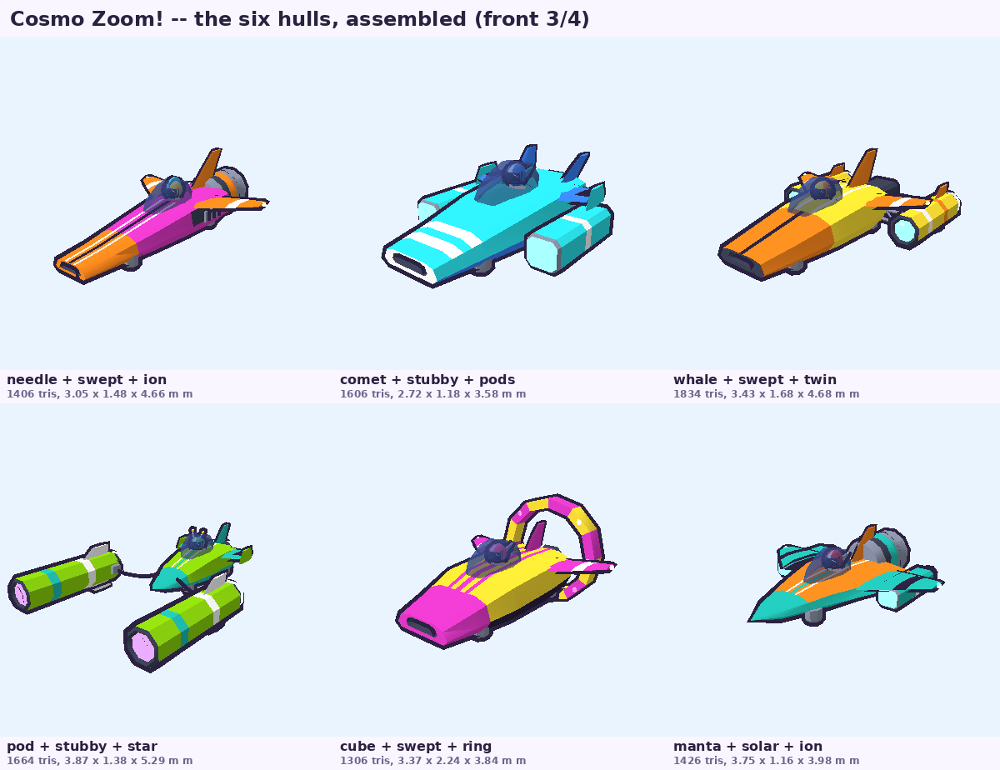
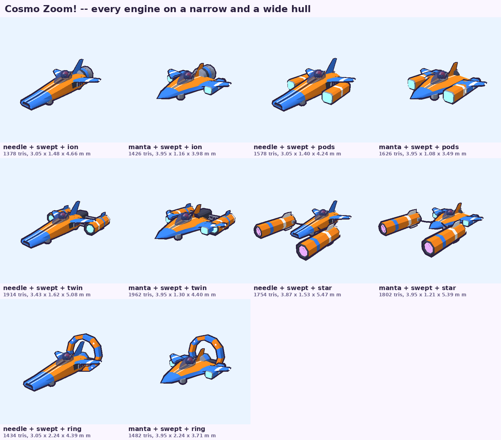
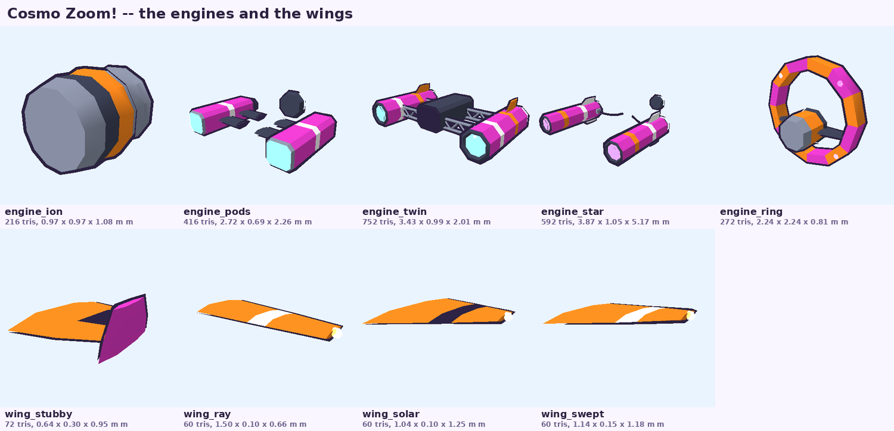
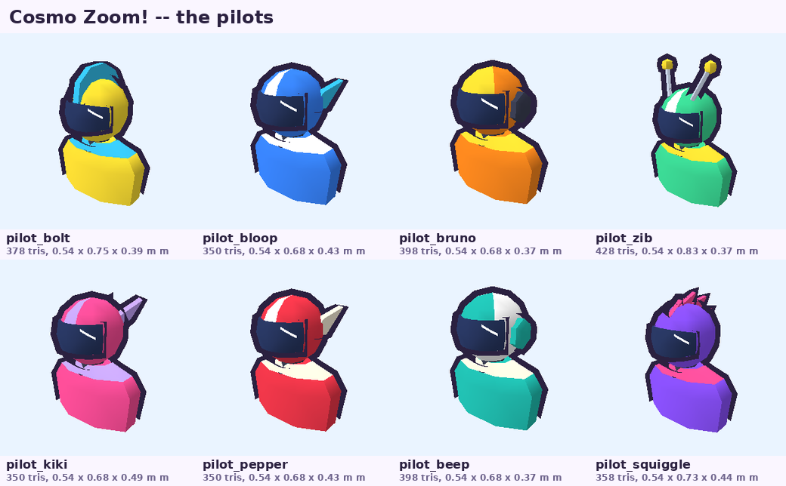
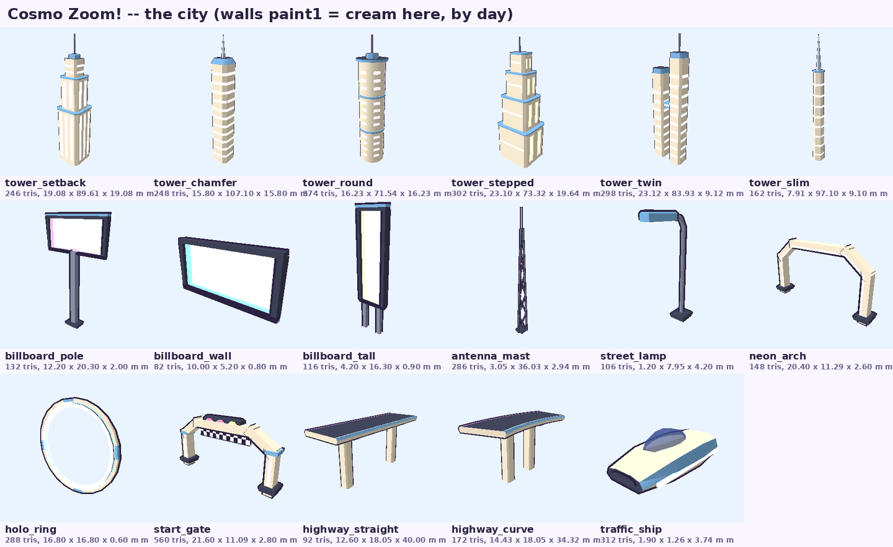
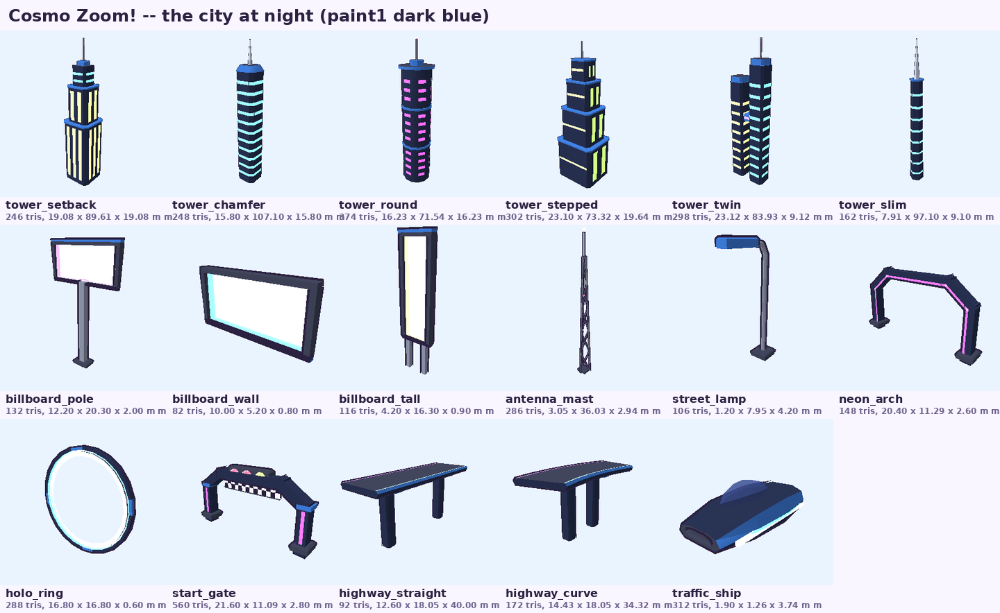
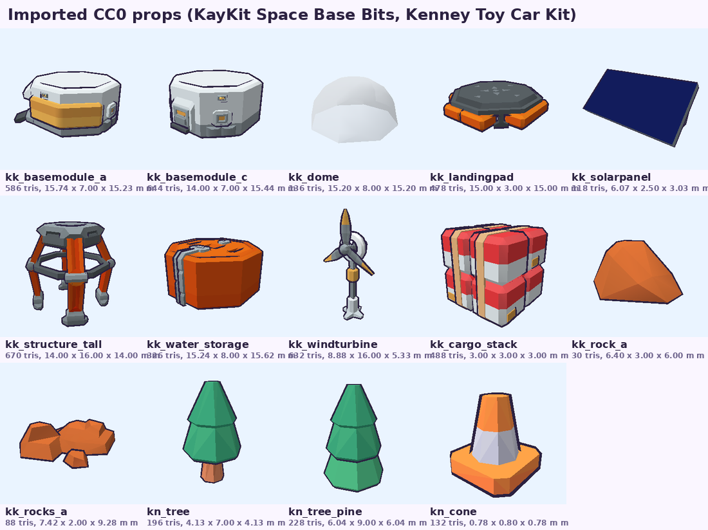

# Cosmo Zoom! — the 3D models

*Every model of the game is made by code, from Python scripts in `tools/cosmozoom/models/` (our own, MIT), plus
a few public-domain (CC0) props converted by `import_cc0.py`. The files go to
`sdcard/apps/cosmozoom.app/models/<name>.obj`, with one shared material file `cosmo.mtl`.*



## 1. Regenerating

```sh
python3 tools/cosmozoom/models/build_all.py            # every .obj + cosmo.mtl (+ the table below)
python3 tools/cosmozoom/models/build_all.py --sheets   # + the contact sheets in docs/hoverkart/models/
python3 tools/cosmozoom/models/preview.py hull_needle  # one model, 4 views, by the game's renderer
python3 tools/cosmozoom/models/preview.py --ship hull_comet wing_swept engine_pods pilot_bloop
```

The previews and the sheets are drawn by the game's own renderer (`tools/tests/cosmozoom/objview.cpp`, compiled to
`/tmp/objview` on the first use: the toon light, the outline, the glass, the glow), with `paint1` / `paint2` given
sample colours. `import_cc0.py` needs the two CC0 packs (`CZ_KAYKIT`, `CZ_KENNEY`; it skips quietly without them,
and the converted files stay in the repository).

| Script | What it makes |
|---|---|
| `czmodel.py` | the little modeller: lofts through section rings, revolutions, rounded boxes, tori, tubes along paths, bevelled slabs from 2D outlines, faceted shells; moves, mirrors, merges; materials per face; the `.obj` / `.mtl` writer (welded vertices, triangles, outward winding by signed volume, UVs) |
| `ships.py` | the 6 hulls, the 5 engines, the 4 wings |
| `pilots.py` | the 8 pilots |
| `items.py` | the race objects, the trophies, the podium |
| `city.py` | the city: skyscrapers, billboards, masts, lamps, arches, holo-ring, start gate, highways, traffic ship |
| `import_cc0.py` | the CC0 props (`kk_*` from KayKit, `kn_*` from Kenney) |
| `preview.py`, `build_all.py` | the previews, the contact sheets, this table |

## 2. Conventions

- Metres; **+Y up, +Z forward** (a ship's nose), right-handed: a ship's **left is +X**. Faces counter-clockwise
  seen from outside (the game culls back faces); triangles only; no normals (the game computes them: smooth, the
  edges sharper than ~40° kept hard — the ships are modelled with real creases for that).
- **Sockets**: comment lines `#@ name x y z`. **Groups** (`o name`): the parts the game may move.
- Each `.obj` starts with `mtllib cosmo.mtl`; `vt` UVs: a side projection over the model's length (z) and height
  (y), 0..1 (the paint patterns); the billboards' picture panels have their own 0..1 UVs.
- **Origins**: a hull at the ship's centre with y = 0 under its hover pads; a wing at its root (made for the +X
  side: the game mirrors it to −X); an engine at its front centre (the hull's `engine` socket); a pilot at the neck;
  the capsule, the bubble, the star bit, the cloud and the warp star at their centre; everything else (props,
  trophies, podium, goo, gravity well) on y = 0 at the centre of its base.

### 2.1 The materials (`cosmo.mtl`, 43 of the loader's 48)

| Kind | Names |
|---|---|
| the player's colours (recoloured by the game) | `paint1` (the body: Kd 0.9 grey), `paint2` (the second colour block: noses, trims, fins; 0.6 grey) |
| fixed colours | `white`, `cream`, `ink` (the black racing stripes), `darkgrey` / `grey` / `silver` (mechanics: nozzles, grilles, pads, trusses), `pink`, `magenta`, `yellow`, `orange`, `red`, `mint`, `green`, `teal`, `cyan`, `sky`, `blue`, `navy` (the visors), `grape`, `lavender`, `gold`, `darkgreen`, `stone`, `sand`, `wood`, `peach` |
| see-through | `tint` (the ships' dark canopies, d 0.62), `glass` (d 0.35), `holo` (the capsule, d 0.40), `bubble` (d 0.45) |
| glowing (`*_glow`: unlit, added, no outline) | `plasma_glow` (hover pads), `cyan_glow`, `purple_glow`, `magenta_glow` (nozzle cores, intakes, neon), `yellow_glow`, `lime_glow`, `pink_glow`, `orange_glow`, `red_glow` (masts' lights) |
| unlit, not outlined (`Ke`) | `ink_flat`, `white_flat` (the visors' glints) |

## 3. The ships

A ship = a hull + the wing (twice, mirrored) + an engine + a pilot, put together by `scene.h buildShip`: the
wing at the hull's `wing` socket, the engine at `engine`, the pilot at `pilot`. Assembled ships weigh
**1300–2450 triangles** (all 6 × 5 × 4 combinations stay under 2500).

| Hull (file) | The concept sheet's ship | Look | Sockets |
|---|---|---|---|
| `hull_needle` | Nova Streak | a long wedge, a flat paint2 nose with an intake mouth, two white + one black stripes on the nose, a dark side grille, a swept fin | wing, engine, pilot, pad1–4 |
| `hull_comet` | Comet Chaser | a chunkier wider wedge, an intake mouth, white stripes across the nose, twin canted fins | same |
| `hull_whale` | Star Drifter | a two-tone wedge (paint2 nose, paint1 back), stripes, a tall fin | same |
| `hull_pod` | Plasma Runner | a small streamlined cockpit pod, a pointed paint2 nose | same |
| `hull_cube` | Ringmaster | a chunky hull, a paint2 nose and stripes, black lower chines | same |
| `hull_manta` | Manta Ray | a wide flat delta, paint2 trims and nose, **two engine pods built in** at its wing ends | same + `flame3`, `flame4` (its pods' nozzles) |

- Every hull puts its **`engine` socket at y = 0.42** (the centre of its back plate) and its **`wing` socket high
  on the shoulders** (y 0.48–0.74): the side engines pass under the wings.
- The pilot sits in the cockpit under a dark tinted faceted canopy (`tint`).
- The 4 hover pads (short grey cylinders with a `plasma_glow` disc under them) are at the `pad1..pad4` sockets.

| Engine (file) | Look | Sockets / groups |
|---|---|---|
| `engine_ion` | one big central jet: a grey nozzle, a paint2 band, a purple glowing core | `flame1` |
| `engine_pods` | two boxy paint1 pods on short dark pylons at the hull's sides (mid-length, forward of the socket), cyan glowing intakes, nozzles behind | `flame1`, `flame2` |
| `engine_twin` | two faceted nacelles held out on grey lattice truss arms from a central block | `flame1`, `flame2` |
| `engine_star` | two long podracer nacelles **out ahead** of the hull (z +2.4…+5.0 from the socket, x ±1.62), purple glowing intakes, pulling the hull on two dark cables | `flame1`, `flame2`, **`arc1`, `arc2`** (the inner faces: the game draws the energy arc between them) |
| `engine_ring` | a big faceted ring (12 segments, paint1/paint2 in turn, 4 magenta lights) standing over the tail on two struts, a core nozzle | `flame1`; `o ring` + the socket `ring` (its centre: it can spin about Z there) |

| Wing (file) | Look |
|---|---|
| `wing_stubby` | Stubby Fins: short thick trapezoids, a black band, a paint1 end plate |
| `wing_ray` | Ray Wings: long straight blades, a white band, a lemon tip light |
| `wing_solar` | (shown as "Delta Fins"): a flat delta, a black band, a cyan tip light |
| `wing_swept` | Swept Fins: swept-back blades, a white band, a lemon tip light |

Known overlaps (small, accepted): on the very wide `hull_manta`, `engine_pods` sit on the delta's edges and
`engine_twin`'s nacelles touch its built-in pods.




## 4. The pilots

Eight racing pilots (no faces): a helmeted head with a tinted `navy` visor and its glint, the shoulders in the
racing suit — each in its own colours and with its own helmet: side fins, ear cups, a crest, antennae, a punk
ridge, rear blades. Origin at the neck (the hull's `pilot` socket), facing +Z, about 0.68–0.83 m high (0.30 m of
it under the neck, hidden in the cockpit). Groups: **`o head`** (the helmet and what is on it: it turns), **`o
body`**. The file names keep the first cast's names (the game maps them): `pilot_pepper` (red, side fins),
`pilot_bruno` (orange, ear cups), `pilot_bolt` (yellow, a sky crest), `pilot_zib` (mint, antennae),
`pilot_beep` (white and teal, ear cups), `pilot_bloop` (blue, side fins), `pilot_squiggle` (grape, a pink
ridge), `pilot_kiki` (pink, lavender rear blades). 350–430 triangles each.



## 5. The race objects

| File | Look | Notes |
|---|---|---|
| `itembox` | the item capsule: a holographic `holo` crystal cube 1.2 m, neon edges (magenta / cyan / lemon glow), a magenta "?" inside | `o shell`, `o symbol` (the "?" may spin on its own) |
| `bubble` | the plasma bubble 1.4 m: a see-through pink sphere crossed by two white energy rings, a magenta core | |
| `goo` | the ion goo: a mint puddle 3 m × 0.3 m, a lime centre, bubbles and droplets | on the ground |
| `spring` | the gravity well: a hexagonal pad, a glowing disc, three grape blades, a magenta orb and a tilted grape ring | `o ring`, socket `ring` |
| `starbit` | a faceted gold star 0.5 m | 20 triangles |
| `nebula` | the storm cloud: faceted grape and lavender puffs, two lemon lightning bolts under it | no face |
| `warpstar` | a big faceted yellow star 3 m with a white rim and glowing tips | |
| `trophy_moon`, `trophy_nebula`, `trophy_supernova`, `trophy_galaxy` | a gold cup on a dark plinth, the cup's emblem over it (a crescent, a swirl, a burst, a two-armed spiral) | |
| `podium` | three paint1 steps (1st in the middle), paint2 trims, the numbers 1 2 3 in gold / silver / orange, cyan light strips | |


## 6. The city

Walls in **`paint1`** (the game sets it per circuit: cream by day, dark blue by night), trims and terraces in
**`paint2`**, windows in `*_glow` strips standing a few centimetres off the walls.

| File | Look |
|---|---|
| `tower_setback` | 90 m: three blocks with setbacks and terraces, vertical yellow window strips, a mast |
| `tower_chamfer` | 107 m: a chamfered square tower, cyan window bands, a leaning crown, a spire with a red light |
| `tower_round` | 72 m: a 12-sided cylinder, two ring ledges, magenta windows, a rooftop disc and mast |
| `tower_stepped` | 73 m: four stepped blocks with terraces, lime strips and yellow bands |
| `tower_twin` | 84 m: two slim towers (cyan / yellow windows) joined by a sky bridge with a magenta band |
| `tower_slim` | 97 m: a slender tapering hexagonal needle, cyan bands, a long spire |
| `billboard_pole`, `billboard_wall`, `billboard_tall` | neon billboards (magenta / cyan / lime panels) in dark frames, on a pole, for a wall, on legs: **`o panel`** has UVs 0..1 for the game's picture |
| `antenna_mast` | a 36 m three-legged lattice mast, red glowing lights |
| `street_lamp` | an 8 m lamp, a paint2 head with a cyan neon bar |
| `neon_arch` | an angular arch over the track (18 m wide, 10 m high), magenta neon on its front, cyan on its back |
| `holo_ring` | a 16 m glowing cyan ring (`o glow`) in a thin paint1 rim; its centre 8 m above its origin |
| `start_gate` | the start gate: an angular arch 19 m wide over the 16 m track, magenta neon on its legs, a checker banner, **three lights `o light1`, `o light2` (red), `o light3` (lime)** front and back |
| `highway_straight`, `highway_curve` | elevated highway pieces for the background (12 m wide, its deck 18 m up; 40 m straight, a 30° curve of radius 60 m), pillars, glowing edge strips (cyan / magenta) |
| `traffic_ship` | a 3.7 m flying car: a tinted canopy, cyan side lights, magenta tail lights, a glowing belly |




## 7. Imported CC0 props

Converted by `import_cc0.py`: the pack's palette texture sampled at each face's UV centre and baked into the
vertices (`v x y z r g b`; the game's loader reads them), scaled to metres, the origin at the base's centre.
Public domain (CC0); credited in each file's header:

- **KayKit Space Base Bits** by Kay Lousberg (CC0, www.kaylousberg.com): `kk_basemodule_a` (basemodule_A),
  `kk_basemodule_c` (basemodule_C), `kk_dome` (dome: its glass in `glass`), `kk_landingpad` (landingpad_large),
  `kk_solarpanel` (solarpanel), `kk_structure_tall` (structure_tall), `kk_water_storage` (water_storage),
  `kk_windturbine` (windturbine_tall + windturbine_tall_fan as **`o fan`**, socket `fan` at the hub: it spins about
  Z), `kk_cargo_stack` (cargo_A_stacked), `kk_rock_a` (rock_A), `kk_rocks_a` (rocks_A).
- **Toy Car Kit** by Kenney (CC0, www.kenney.nl): `kn_tree` (tree), `kn_tree_pine` (tree-pine), `kn_cone`
  (item-cone). No car.



## 8. Every file

Generated by `build_all.py` (the triangles as the game counts them):

<!-- table -->
| Model | Triangles | Size x × y × z (m) | Sockets | Groups | Script |
|---|---|---|---|---|---|
| `antenna_mast` | 286 | 3.05 × 36.03 × 2.94 | — | — | city.py |
| `billboard_pole` | 132 | 12.20 × 20.30 × 2.00 | — | panel | city.py |
| `billboard_tall` | 116 | 4.20 × 16.30 × 0.90 | — | panel | city.py |
| `billboard_wall` | 82 | 10.00 × 5.20 × 0.80 | — | panel | city.py |
| `bubble` | 372 | 1.36 × 1.40 × 1.36 | — | — | items.py |
| `engine_ion` | 216 | 0.97 × 0.97 × 1.08 | flame1 | — | ships.py |
| `engine_pods` | 416 | 2.72 × 0.69 × 2.26 | flame1, flame2 | — | ships.py |
| `engine_ring` | 272 | 2.24 × 2.24 × 0.81 | ring, flame1 | ring | ships.py |
| `engine_star` | 592 | 3.87 × 1.05 × 5.17 | flame1, arc1, flame2, arc2 | — | ships.py |
| `engine_twin` | 752 | 3.43 × 0.99 × 2.01 | flame1, flame2 | — | ships.py |
| `goo` | 580 | 3.51 × 0.30 × 3.03 | — | — | items.py |
| `highway_curve` | 172 | 14.43 × 18.05 × 34.32 | — | — | city.py |
| `highway_straight` | 92 | 12.60 × 18.05 × 40.00 | — | — | city.py |
| `holo_ring` | 288 | 16.80 × 16.80 × 0.60 | — | glow | city.py |
| `hull_comet` | 696 | 1.60 × 1.18 × 3.58 | pad1, pad2, pad3, pad4, wing, engine, pilot | — | ships.py |
| `hull_cube` | 564 | 1.68 × 1.34 × 3.41 | pad1, pad2, pad3, pad4, wing, engine, pilot | — | ships.py |
| `hull_manta` | 740 | 2.84 × 1.08 × 3.49 | flame3, flame4, pad1, pad2, pad3, pad4, wing, engine, pilot | — | ships.py |
| `hull_needle` | 692 | 1.24 × 1.40 × 4.24 | pad1, pad2, pad3, pad4, wing, engine, pilot | — | ships.py |
| `hull_pod` | 500 | 1.12 × 1.16 × 3.14 | pad1, pad2, pad3, pad4, wing, engine, pilot | — | ships.py |
| `hull_whale` | 564 | 1.60 × 1.46 × 3.86 | pad1, pad2, pad3, pad4, wing, engine, pilot | — | ships.py |
| `itembox` | 448 | 1.20 × 1.20 × 1.20 | — | shell, symbol | items.py |
| `kk_basemodule_a` | 586 | 15.74 × 7.00 × 15.23 | — | — | import_cc0.py |
| `kk_basemodule_c` | 644 | 14.00 × 7.00 × 15.44 | — | — | import_cc0.py |
| `kk_cargo_stack` | 488 | 3.00 × 3.00 × 3.00 | — | — | import_cc0.py |
| `kk_dome` | 136 | 15.20 × 8.00 × 15.20 | — | — | import_cc0.py |
| `kk_landingpad` | 478 | 15.00 × 3.00 × 15.00 | — | — | import_cc0.py |
| `kk_rock_a` | 30 | 6.40 × 3.00 × 6.00 | — | — | import_cc0.py |
| `kk_rocks_a` | 88 | 7.42 × 2.00 × 9.28 | — | — | import_cc0.py |
| `kk_solarpanel` | 118 | 6.07 × 2.50 × 3.03 | — | — | import_cc0.py |
| `kk_structure_tall` | 670 | 14.00 × 16.00 × 14.00 | — | — | import_cc0.py |
| `kk_water_storage` | 326 | 15.24 × 8.00 × 15.62 | — | — | import_cc0.py |
| `kk_windturbine` | 632 | 8.88 × 16.00 × 5.33 | fan | fan | import_cc0.py |
| `kn_cone` | 132 | 0.78 × 0.80 × 0.78 | — | — | import_cc0.py |
| `kn_tree` | 196 | 4.13 × 7.00 × 4.13 | — | — | import_cc0.py |
| `kn_tree_pine` | 228 | 6.04 × 9.00 × 6.04 | — | — | import_cc0.py |
| `nebula` | 460 | 2.62 × 1.83 × 2.27 | — | — | items.py |
| `neon_arch` | 148 | 20.40 × 11.29 × 2.60 | — | — | city.py |
| `pilot_beep` | 398 | 0.54 × 0.68 × 0.37 | — | body, head | pilots.py |
| `pilot_bloop` | 350 | 0.54 × 0.68 × 0.43 | — | body, head | pilots.py |
| `pilot_bolt` | 378 | 0.54 × 0.75 × 0.39 | — | body, head | pilots.py |
| `pilot_bruno` | 398 | 0.54 × 0.68 × 0.37 | — | body, head | pilots.py |
| `pilot_kiki` | 350 | 0.54 × 0.68 × 0.49 | — | body, head | pilots.py |
| `pilot_pepper` | 350 | 0.54 × 0.68 × 0.43 | — | body, head | pilots.py |
| `pilot_squiggle` | 358 | 0.54 × 0.73 × 0.44 | — | body, head | pilots.py |
| `pilot_zib` | 428 | 0.54 × 0.83 × 0.37 | — | body, head | pilots.py |
| `podium` | 344 | 7.80 × 2.00 × 2.53 | — | — | items.py |
| `spring` | 416 | 1.39 × 1.21 × 1.60 | ring | ring | items.py |
| `starbit` | 20 | 0.48 × 0.45 × 0.16 | — | — | items.py |
| `start_gate` | 560 | 21.60 × 11.09 × 2.80 | — | light1, light2, light3 | city.py |
| `street_lamp` | 106 | 1.20 × 7.95 × 4.20 | — | — | city.py |
| `tower_chamfer` | 248 | 15.80 × 107.10 × 15.80 | — | — | city.py |
| `tower_round` | 374 | 16.23 × 71.54 × 16.23 | — | — | city.py |
| `tower_setback` | 246 | 19.08 × 89.61 × 19.08 | — | — | city.py |
| `tower_slim` | 162 | 7.91 × 97.10 × 9.10 | — | — | city.py |
| `tower_stepped` | 302 | 23.10 × 73.33 × 19.64 | — | — | city.py |
| `tower_twin` | 298 | 23.12 × 83.92 × 9.12 | — | — | city.py |
| `traffic_ship` | 312 | 1.90 × 1.26 × 3.74 | — | — | city.py |
| `trophy_galaxy` | 482 | 1.09 × 1.81 × 0.84 | — | — | items.py |
| `trophy_moon` | 402 | 1.09 × 1.85 × 0.84 | — | — | items.py |
| `trophy_nebula` | 406 | 1.09 × 1.86 × 0.84 | — | — | items.py |
| `trophy_supernova` | 426 | 1.09 × 1.90 × 0.84 | — | — | items.py |
| `warpstar` | 260 | 3.36 × 3.21 × 1.20 | — | — | items.py |
| `wing_ray` | 60 | 1.50 × 0.10 × 0.66 | — | — | ships.py |
| `wing_solar` | 60 | 1.04 × 0.10 × 1.25 | — | — | ships.py |
| `wing_stubby` | 72 | 0.65 × 0.30 × 0.95 | — | — | ships.py |
| `wing_swept` | 60 | 1.15 × 0.15 × 1.18 | — | — | ships.py |
<!-- /table -->

## 9. For the programmer

- The names in `parts.h` (`hull_dart`, `wing_glider`, `engine_big`, `pilot_pip`…) are an older list: the files are
  the ones above (`hull_needle`… `engine_pods`… `pilot_pepper`…).
- The hull's `flame*` sockets are read by `buildShip` too: `hull_manta`'s `flame3` / `flame4` give its built-in pods
  their trails.
- `engine_star`'s nacelles reach 5 m ahead of the `engine` socket: about 1–3 m ahead of the nose, as on the sheet.
- The loader keeps 24 groups and 24 sockets a model and 48 materials: `cosmo.mtl` has 43.
- The material set changed during the design (`graphite` → `darkgrey`, `steel` → `grey`; the animal-fur colours
  are gone): nothing else uses them.
